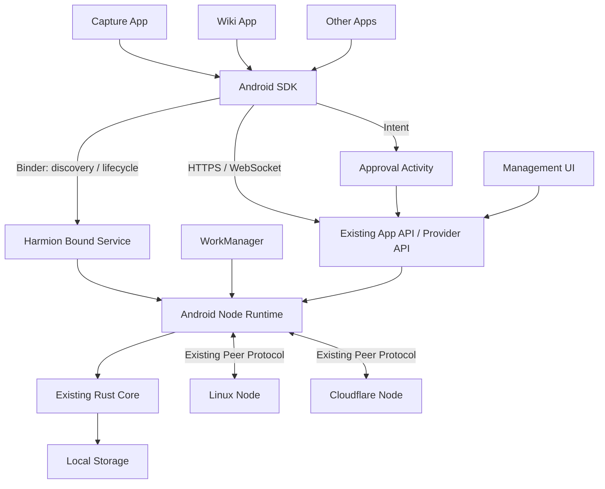

# Harmion for Android — 要件定義・実装指針

## 1. 目的

HarmionのAndroid版ノードおよび付属管理アプリケーションを開発する。

Android版は単なる同期クライアントではなく、Android上の各種アプリケーションがHarmionを利用するための汎用的なローカルノードとして位置付ける。

### 開発の背景

現在、PC向けHarmion Wikiはある程度実用可能な段階に達しているが、日常的な利用には至っていない。

主な原因として、スマートフォンから気軽に情報を記録・参照できないことがある。現在はDiscordの自分用DMやChatGPTが思考の主な出力先になっている。

将来的には、以下のワークフローを実現したい。

- スマートフォンからテキスト・音声によって思考を即座に記録する。
- Twitter風のタイムラインUIを持つCaptureアプリで記録を管理する。
- 記録した内容をHarmionによって他の端末と同期する。
- PC上のWikiや他のアプリケーションで、必要に応じて情報を整理・構造化する。
- 将来的にはPebble Time 2なども入力端末として利用する。

ただし、今回の開発対象はAndroid版ノードとその管理アプリケーション、利用アプリ向けの接続基盤である。CaptureやWikiのAndroid版そのものは別途開発する。

## 2. 基本設計原則

- 既存のRust製Harmion Coreを再利用する。
- Android独自のCoreを再実装しない。
- 既存のデータモデル・競合解決の意味論・同期プロトコル・認可モデルとの互換性を維持する。
- Android固有の実装は、OS統合・ライフサイクル・IPC・鍵管理・UIなどに集中させる。
- 一端末ノードにつき一つのノードサービスとDBを持つ。
- 各利用アプリが個別にCoreやDBを所有する構成にはしない。
- 管理画面とノードサービスは一つのAndroidアプリケーションとして提供する。
- Wiki、Capture、Ledgerなどは原則として独立したマイクロアプリケーションとする。スーパーアプリ化しない。
- rootやADB、Shizukuへの依存を前提としない。

Shizukuはサービスと利用アプリの関係、認可UX、管理画面のデザインに関する参考とする。

## 3. アーキテクチャ

以下の構成を基本とする。

### 技術選定

推奨構成は以下のとおり。

| 領域 | 技術・方式 |
|---|---|
| Androidホスト | Kotlin |
| UI | Jetpack Compose |
| デザイン | Material 3 Expressive |
| Core | 既存Rust実装 |
| FFI | JNIまたはUniFFI |
| サービス接続 | Bound Service / Binder |
| データ通信 | 既存HTTPS App API |
| Interpreter通信 | 既存Provider WebSocket |
| バックグラウンド同期 | WorkManager等 |
| 鍵管理 | Android Keystore |
| 所有者認証 | BiometricPrompt |
| ウィジェット | Jetpack Glance等 |

具体的なライブラリ、FFI方式、ビルド構成は、既存コードの構造を確認した上で選定してよい。

## 4. ノード間同期

### 必須要件

- 既存のLinuxノードと相互同期できること。
- Cloudflare Workers / Durable Objects上のノードと相互同期できること。
- 既存のPeerプロトコルを利用すること。
- オフライン状態でのローカル読み書きを可能にすること。
- ネットワーク復帰後に同期を再開できること。
- プロセス終了・端末再起動後もノードのアイデンティティ、保存済みデータ、同期カーソルなどを維持すること。
- 既存の永続カーソルとページ単位の同期処理を活用すること。

Cloudflareノードは常設レプリカであり、primaryではない。Android版の利用にCloudflareを必須としない。

### 着信接続

Androidノードからの発信接続だけでなく、他ノードからAndroidノードへの着信接続も許容する。

ただし以下を区別する。

- Androidから同期を開始できることは必須。
- Androidが稼働しており、到達可能であれば、他ノードから同期を開始してよい。
- Androidノードの常時到達可能性は保証しない。
- 着信接続を待つためだけの常駐は必須としない。
- 着信を契機とした停止中のノードの自動起動は保証しない。
- 着信・発信の双方に既存の認証・参加資格検査を適用する。
- 着信によってユーザーの同期ポリシーを迂回できないようにする。

Androidのネットワーク権限、LANアクセス権限、ネットワーク切り替えなども考慮する。

## 5. 同期ポリシー

ユーザーが同期条件を設定できるようにする。

### 設定項目

| 分類 | 設定候補 |
|---|---|
| 自動同期 | 有効 / 無効 |
| ネットワーク | Wi-Fiのみ / 非従量制回線のみ / すべて |
| バッテリー | 制限なし / 残量低下時は停止 / 充電中のみ |
| ローミング | 許可 / 禁止 |
| 定期同期 | 15分 / 30分 / 1時間 / 無効など |
| ローカル更新時 | 同期要求の有効 / 無効 |
| アプリ接続時 | 同期要求の有効 / 無効 |
| ネットワーク復帰時 | 同期要求の有効 / 無効 |

具体的な選択肢・初期値は暫定であり、実装上の妥当性を検討して決定してよい。

Wi-Fiへの接続状態と非従量制回線であることは区別する。また、単にWi-Fiに接続しているかではなく、実際の通信経路を考慮する。

### 同期スケジューリング

以下を同期開始の契機とする。

- ローカルデータの更新
- 利用アプリの接続
- ネットワークの復帰
- 定期的なバックグラウンドジョブ
- ユーザーによる手動操作
- 他ノードからの着信接続

連続した更新による過剰な通信を避けるため、同期要求の集約やdebounceを行う。失敗時はbackoffを利用する。

同期条件を満たさなくなった場合は安全に中断し、条件が成立した後に永続カーソルから再開する。

手動同期で通常の同期条件を上書きする場合は、ユーザーに明示的な確認を求め、今回の同期に限定する方式を推奨する。

同期が停止していてもローカルデータの読み書きは可能でなければならない。

## 6. プロセスのライフサイクル

Linuxの常駐daemonをそのままAndroidに移植する設計は採用しない。

Androidのバックグラウンド実行制限を前提として、オンデマンドで起動・停止可能なノードサービスを設計する。

### Runtimeの稼働理由

- 管理画面が利用されている。
- 利用アプリがBound Serviceに接続している。
- 同期ジョブを実行している。
- Interpreterの処理など、実行中の要求が存在する。

これらが存在しない場合、Runtimeは停止可能とする。

Activity、Service、Workerが独立してCoreやDBを初期化することは避け、Runtimeの所有・初期化・終了を一元管理する。

Runtimeの起動状態と同期の実行状態は独立して扱う。例えば、Runtimeが稼働していても同期条件を満たさないため同期が停止している状態を認める。

### 状態の永続化

Androidによる予告なしのプロセス終了を考慮する。

正常な終了処理にデータ整合性を依存させない。再起動時に保存済みデータ、同期状態、認可情報などを復元する。

常時バックグラウンド同期や正確な定期実行間隔は保証しない。Foreground Serviceの利用はOSの制約と必要性を考慮する。

## 7. 外部アプリケーションとの接続

### 基本方式

Binderを制御プレーン、既存HTTPS App APIおよびWebSocketをデータプレーンとして利用する。

Binder上にQuery、Edit、Subscribeなどのデータ操作APIを再実装する方式は採用しない。

### Bound Serviceの責任

- ノードのオンデマンド起動。
- App APIの接続先の提供。
- TLS証明書の固定に必要な情報の安全な提供。
- Androidの呼び出し元アプリの識別。
- 接続・認可フローとの連携。
- サービスの生存状態の監視。

利用アプリは必要な間だけServiceへのbindを維持する。

HTTPS App APIはloopbackに限定し、既存のTLS・Bearer Tokenによる認証・認可を維持する。loopback接続であることだけを信頼根拠としない。

Peer APIのリスナーとApp APIのリスナーは明確に区別する。

### アプリの識別

以下を区別する。

- Android UID：現在のBinder呼び出し元の検証。
- Package nameと署名証明書：継続的なAndroidアプリの識別。
- Harmion App ID：Core内部の認可主体。

パッケージ名の自己申告のみを信用しない。

Binderで検証したアプリの識別情報を、実際の認可要求と安全に結び付ける方式を設計する。署名変更、再インストール、複数パッケージが同一UIDを持つ場合なども考慮する。

## 8. アプリケーションの認可

既存のOAuth・PKCE・統合接続APIを可能な限り再利用する。

Android独自の認可モデルを新設するのではなく、既存モデルに対するネイティブな接続・承認アダプターとして実装する。

### 初回接続フロー

1. 利用アプリがHarmion Serviceへbindする。
2. App APIの接続先と証明書情報を取得する。
3. 必要なgrantを指定して統合接続要求を作成する。
4. IntentによってHarmionの承認Activityを起動する。
5. ユーザーが要求元アプリ、権限、有効期間を確認する。
6. 必要な所有者認証を行い、承認または拒否する。
7. 利用アプリが既存の認可手続きによってAccess TokenとRefresh Tokenを取得する。
8. 以後、既存App APIを利用する。

承認ActivityはShizukuやNostrのAmberに近いUXを参考とする。

システム全体に描画するオーバーレイ権限ではなく、ダイアログ風Activityを利用する方向を推奨する。

IntentやActivityの結果に長期資格情報を不用意に含めない。既存のrequest secret、PKCE、stateなどの保護を維持する。

### 認可の有効期限

定期的な再認可は許容する。

ただし、認可Activityにおいてユーザーが認可の有効期間を選択できるようにする。また、利用アプリからIntentを介して有効期間の延長を要求できるようにする。

期間の候補：

- 24時間
- 7日間
- 30日間（デフォルト候補）
- 90日間
- 1年間

具体的な選択肢は暫定とする。

Access Tokenの短い有効期間は維持し、Refresh Token系列または認可自体の絶対有効期限をユーザーが承認した期間に設定する。

通常のRefresh Token更新によって承認済みの絶対有効期限を無制限に延長しない。

延長には明示的なユーザー承認と必要な所有者認証を要求する。延長を理由にgrantを暗黙的に拡大しない。

管理画面から認可の期限確認・延長・短縮・失効を行えるようにする。

現状の30日固定の認可仕様を変更する必要がある場合は、Android限定の例外ではなくCore共通の認可仕様の拡張として検討する。

## 9. Android SDK

将来的なCapture、Wiki、Ledgerなどの開発で再利用できるSDKを用意する。

### SDKの責任

- Bound Serviceへの接続・切断。
- 接続先の発見。
- 認可Activityの起動。
- OAuth資格情報の安全な保存・更新。
- TLS証明書の検証。
- App API・Provider APIの利用。
- ノード停止・再起動時の再接続。
- Subscribeの再開・再取得。
- KotlinのCoroutine / Flowとの統合。

SDKは原則としてComposeなど特定のUIフレームワークに依存させない。

既存Rust SDKをFFIで再利用するか、共通プロトコルに対する薄いKotlin SDKを実装するかは、既存コードを確認して判断してよい。

### 通信切断時の処理

| 操作 | 処理 |
|---|---|
| Query / Get | 再接続後に再取得可能 |
| Save | 既存のrequest IDによる冪等性契約を利用 |
| Subscribe | resumeを試み、必要なら初期取得 |
| Interpreter Call | 無条件に再実行しない |
| 編集中のデータ | 利用アプリ側で保持 |

既存のrequest receiptの保持期限や、結果不明時の再送リスクも考慮する。

## 10. 初回セットアップ・Onboarding

初回起動時に、Material 3 Expressiveに準拠したOnboarding画面を表示する。

主に以下の選択肢を提供する。

- 既存のHarmionクラスタに参加する。
- 新規クラスタを作成し、既存クラスタに参加せず単独ノードとして利用する。

### QRコードによる参加

既存クラスタへの参加はQRコードベースの操作を中心とする。

既存のQRコードによるノード参加・承認機構を再利用する。Androidでの利用に不足する情報や機能がある場合は、既存プロトコルとの整合性を保ちながら必要な拡張を検討する。

- QRコードの読み取り。
- 必要に応じたQRコードの生成・表示。
- クラスタおよび参加対象の確認。
- ノードの鍵・アイデンティティの初期化。
- 参加要求と承認。
- 参加後の初回同期。
- 初回同期の進捗・中断・失敗・再開の表示。

QRコードに含まれる情報だけで自動的に信頼や参加資格を付与しない。既存のmembershipおよび所有者承認の契約を維持する。

クラスタ参加や初回同期に失敗した場合は、安全に再試行できるようにする。

初回同期が完了していない場合は、その状態を明示する。

## 11. 所有者認証・生体認証

Androidの生体認証を重要な管理操作に利用する。

現在の主要な対象端末は生体認証を利用できるGalaxy端末であるため、生体認証が利用できない端末に対する高度な代替UXは初期段階では優先しなくてよい。ただし、認証を迂回する実装は行わない。

### 基本方式

- Android Keystoreによる所有者署名鍵の保護。
- BiometricPromptによる認証。
- 可能であれば操作ごとに認証を要求する暗号鍵を利用する。
- 既存の所有者challenge-response契約との統合。

単なる管理画面のロックとしてではなく、重要操作に対する暗号学的な承認として生体認証を利用する。

既存のSSHSIG契約と互換性を持たせる方式を優先して検討する。Android上の署名アルゴリズム、署名形式、既存の検証実装との互換性はPoCで確認する。

既存実装がssh-keygenなどAndroidに存在しない外部コマンドに依存している場合は、共通のRust検証実装などへの変更を検討する。

### 鍵の分離

- Node signing key
- Transport key
- App API TLS key
- Owner signing key

バックグラウンド同期に必要な鍵と、生体認証を必要とする所有者鍵を分離する。

### 認証対象

既存の所有者認証におけるR2操作を基本とする。

特に以下の操作を対象とする。

- ノード参加承認。
- ノード退役などの重要な管理操作。
- アプリ認可・grantの変更。
- Interpreter提供元の承認。
- 所有者credentialの変更。
- 全量Export。

通常の同期、認可済みアプリからのデータ操作、通常の競合解決では生体認証を毎回要求しない。

生体認証情報の変更による鍵の無効化、機種変更、鍵の喪失を考慮し、既存の所有者回復機構を維持する。

## 12. 管理アプリケーション

Android版ノードと管理アプリケーションを一体として提供する。

PC版管理ツールとの機能的な同等性を可能な限り維持する。ただし、UI構成まで一致させる必要はない。

### 主な管理機能

- ノード全体の状態表示。
- クラスタの作成・参加・離脱。
- ノード一覧・詳細・接続状況。
- QRコードを利用したノード参加・承認。
- アプリケーション一覧。
- アプリケーションのgrant・認可期限・失効管理。
- Interpreterの登録・承認・接続状態の管理。
- 同期ポリシーの設定。
- 手動同期。
- 同期状況・履歴・エラーの表示。
- 競合一覧・競合解決。
- 所有者credentialの管理。
- ストレージ使用状況。
- ログ・診断情報。
- データExport。

既存PC版管理ツールの機能とAPIを実際に調査し、機能差がある場合は理由と今後の対応方針を記録する。

同期状態について、特定Peerとの同期完了をクラスタ全体の完全な同期と誤認させない。

## 13. 競合解決UI

既存Harmionの競合モデルを維持する。

競合の単位は以下のとおり。

- 本文。
- 属性の各キー。
- 個々のkindの所属状態。
- Contentの存在状態。

Content全体を一つの不可分なバージョンとして扱わない。

### UIの基本方針

Content単位の競合一覧を表示し、個別画面から各項目の競合を解決できるようにする。

- 通常表示に選択されている候補を明示する。
- 各候補の本文・値・編集時刻・取得可能な版情報を表示する。
- 候補の選択による解決を可能にする。
- 手動編集による新しい解決値の作成を可能にする。
- 3つ以上の候補に対応する。
- 同じ値を持つ複数版は表示上まとめてもよいが、因果情報を失わない。
- 属性のunset、null、空文字を区別する。
- kindの所属と非所属を区別する。
- 削除競合における保持・削除・復元を正しく区別する。

### 三者マージ

既存のmerge-input APIおよびRust SDKの三者マージ機構を再利用する。

共通祖先が存在する場合はGit的な三者マージ案を提示し、ユーザーが確認・編集して解決を確定できるようにする。

共通祖先が複数存在する場合は選択を可能にする。共通祖先が存在しない場合は候補選択・手動編集にフォールバックする。

スマートフォンではunified diffなどの縦方向の比較を基本とし、必要に応じて横画面や大画面でside-by-side diffを提供する。

### 整合性

- 解決対象はユーザーが確認した版に限定する。
- 解決画面を開いている間に届いた未確認の並行更新を暗黙に解決しない。
- 別ノードで先に解決された場合も編集中の入力を不用意に失わない。
- Keepによって本文や属性などの競合を暗黙に解決しない。
- Restoreの全体置換に関する既存仕様を遵守する。

既存のSelect、Resolve、Keep、Delete、Restore、RestoreFromなどを利用する。

競合一覧・件数の効率的な取得に必要なAPIが不足している場合は、汎用的な管理APIの拡張を検討する。

### 将来の自動マージ

履歴と共通祖先を利用する自動マージは将来的に実装したい。

ただし、無人の自動マージは複数ノードで異なる順序で実行しても収束性を損なわない規則を定義してから導入する。

Android独自の自動マージ規則を作らない。

## 14. 通知・ウィジェット

Android固有の通知機構を積極的に活用する。

### 通知対象

- 未解決のContent競合。
- ノード参加・管理承認要求。
- アプリケーションの接続承認要求。
- 継続的な同期エラー。
- ストレージ不足。
- その他、ユーザーによる対応が必要な状態。

競合通知をタップすると対応する競合一覧または競合解決画面に遷移する。

承認要求の通知からも対応する承認画面へ遷移できるようにする。

通知を適切に集約し、同一の状態について過剰に通知しない。他ノードで競合が解決された場合などは通知も更新・消去する。

通常の同期完了や一時的な接続・切断を逐一通知する必要はない。

通知権限が拒否されていても、管理画面から必要な操作を行えるようにする。

ロック画面の通知では、デフォルトでContent本文や機密情報を表示しない。

### ウィジェット

将来的にホーム画面ウィジェットを提供する。

表示候補：

- 同期状態。
- 最終同期時刻。
- 未同期の更新。
- 未解決の競合。
- 同期停止理由。
- 手動同期ボタン。

クイック設定タイルも将来的な候補とする。

ウィジェット・クイック設定タイルは初期実装の成立条件にはしない。

## 15. UI・デザイン

Jetpack ComposeおよびMaterial 3 Expressiveを採用する。

単にMaterialコンポーネントを使用するだけではなく、洗練されたネイティブAndroid管理アプリとして設計する。

ShizukuなどをデザインおよびUXの参考とする。

### デザイン要件

- Material 3 Expressiveへの準拠。
- Dynamic Color対応。
- Light / Dark Theme対応。
- Edge-to-edge対応。
- 明確な情報階層。
- 適切な余白とタイポグラフィ。
- 状態変化に対応したモーション。
- 同期状況・エラー・承認要求などを直感的に把握できること。
- アクセシビリティおよび文字サイズ変更への対応。
- スマートフォンに適した操作性。

管理アプリのホーム画面では特にノードの稼働状態、同期状態、対応が必要な問題を分かりやすく表示する。

過度な装飾や独自コンポーネントの乱造は避ける。

具体的な画面構成、ナビゲーション、コンポーネント選定は実装段階で改善してよい。

## 16. Interpreter

既存のInterpreter仕様を維持する。

Interpreterは原則として別アプリケーションまたは別プロセスから既存Provider APIを通じて接続する。

Android版v1では、未起動のInterpreterの自動起動や常時利用可能性を保証する必要はない。

### 将来の拡張候補

- Bound ServiceによるInterpreter提供元のオンデマンド起動。
- 独立したWasm Interpreter Runner。
- 遠隔ノードのInterpreter利用。

Wasm Runnerを実装する場合も、Coreに特定の実行環境を直接組み込むことは避け、既存Provider APIに対応する独立した実行環境を優先する。

### hledger

将来的にPlain Text Accounting用途でhledger互換のInterpreterを開発する可能性がある。

候補は以下のとおり。

- hledger-libのAndroid向けネイティブビルド。
- hledgerのWasmへの移植。
- 独自の互換実装。

現段階では方式を決定しない。hledgerの対応をAndroid版ノードの開発条件にしない。

## 17. ストレージ・バックアップ

- アプリ専用ストレージにノードのDBと必要な永続状態を保存する。
- 既存のDB migrationを再利用する。
- ノード鍵や資格情報を適切に保護する。
- Android Auto BackupによるノードID・秘密鍵の意図しない複製や、機密データの外部送信を防ぐ。
- ストレージ不足を検出し、適切なエラーを表示する。
- DB・履歴によるストレージ使用量を確認できるようにする。
- 機種変更時は原則として新規ノードとしてクラスタへ参加する方式を想定する。

部分同期や履歴削減をAndroid独自の機能として実装しない。必要になった場合はCore共通機能として設計する。

未同期データが存在する場合の離脱・データ消去などでは、ユーザーにデータ喪失の可能性を明示する。

## 18. 実装順序

以下を推奨する。既存コードの依存関係や実装状況に応じて調整してよい。

### Phase 0: 調査・設計

- 既存の仕様書・ソースコード・実装進捗を確認する。
- Rust CoreのAndroidへの移植可能性を確認する。
- 既存Peer transport、ストレージ、暗号ライブラリ、所有者認証のAndroid互換性を確認する。
- PC版管理ツールの機能を確認する。
- 不足している共通APIや変更が必要な仕様を特定する。
- Android固有の設計をandroid-design.mdなどに整理する。

### Phase 1: Androidノード

- Rust Coreの組み込み。
- 永続ストレージ。
- Runtimeのライフサイクル管理。
- Linux・Cloudflareとの同期。
- バックグラウンド同期と同期ポリシー。

### Phase 2: 管理アプリケーション

- Material 3 Expressiveによる基本UI。
- Onboarding。
- QRコードによる参加・承認。
- ノード管理。
- 同期設定・状態表示。
- 所有者認証。

### Phase 3: 利用アプリとの接続

- Bound Service / Binder。
- ネイティブ認可Activity。
- Android SDK。
- 既存App APIへの接続。
- 認可期限の選択・延長。
- 外部アプリからの読み書き・Subscribe。

Phase 3の成立後、Captureアプリの開発を開始できる状態を目指す。

### Phase 4: 運用品質

- 競合解決UI。
- 三者マージUI。
- 通知。
- ストレージ・Export・診断機能。
- PC版管理機能との同等性の改善。
- 実機での長期運用テスト。

### Phase 5: 将来的な拡張

- ウィジェット。
- クイック設定タイル。
- Interpreterのオンデマンド起動。
- Wasm Runner。
- Pebble等との連携。

## 19. テスト・受け入れ条件

少なくとも以下のシナリオを検証する。

- QRコードから既存クラスタに参加できる。
- 既存クラスタに参加せず単独利用を開始できる。
- Linux・Cloudflare・Android間で更新が収束する。
- Androidでオフライン保存したデータが再接続後に同期される。
- 稼働中のAndroidノードが、到達可能な環境でPeerからの着信接続を受理できる。
- 同期途中のネットワーク切り替えやプロセス終了によってデータ整合性が失われない。
- Wi-Fi・バッテリー・モバイル通信に関する同期ポリシーが守られる。
- 同期が停止していてもローカル保存が可能である。
- 外部AndroidアプリがIntentによる認可を経てApp APIを利用できる。
- 認可されていないアプリや失効済み資格情報からのアクセスが拒否される。
- 認可期限の延長が暗黙の権限拡大につながらない。
- 重要な管理操作が所有者認証を迂回できない。
- ノード再起動後にSDKが適切に再接続できる。
- 競合解決中に新しい更新が到着しても、未確認の版が失われない。
- Androidの通知権限が拒否されていても管理機能を利用できる。

可能な限り既存の共通テスト、プロトコルfixture、統合テストを再利用する。

## 20. 実行エージェントへの指示

この文書はAndroid版の要求・設計方針であり、既存仕様を無条件に置き換えるものではない。

まず以下の既存文書を確認すること。

- specification.md
- architecture.md
- internal-design.md
- app-api.md
- app-save-v1.md
- membership-v1.md
- peer-v1.md
- https-peer-v2-draft.md
- interpreter-v1.md
- export-v1.md
- record-v1.md
- その他、最新の実装進捗・レビュー・所有者認証・Cloudflare関連文書

文書の記述だけで実装済みと判断せず、実際のソースコードとテストを確認すること。

既存仕様と今回の要件に不整合がある場合は、その内容・変更理由・既存機能への影響を明示すること。

特にCoreの意味論、同期プロトコル、認証認可、所有者認証、永続データ形式に関する重大な変更を無断で行わないこと。

一方で以下は実装上の判断として委任する。

- KotlinとRust間のFFI方式。
- Gradle・Nix・Android NDKなどのビルド構成。
- 具体的なライブラリ選定。
- 最低対応AndroidバージョンとABI。
- Binderインターフェースの具体的な型。
- SDKの内部実装。
- 同期スケジューラの細部。
- 画面構成とナビゲーション。
- Material 3 Expressiveの具体的なコンポーネント利用。
- QRコード参加機構の互換性を維持した拡張方法。

まず調査と設計を行い、Android固有の仕様を文書化する。その後、段階的に実装・検証を進めること。

完成度の高いUIを先に作り続けることよりも、実際にAndroidノードを利用し、外部アプリからデータを書き込み、複数端末で同期できる状態に到達することを優先する。
