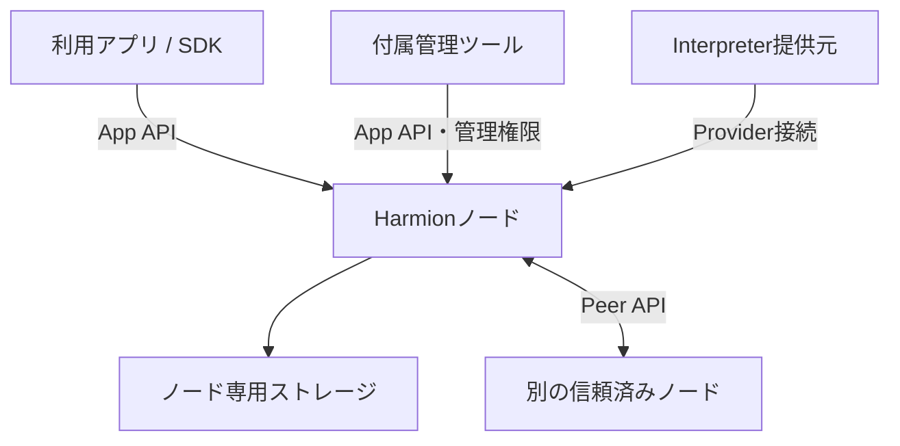

# Architectureとパッケージ構成

更新日: 2026-11-18

native管理クライアントの入口は証明書を固定したloopback HTTPS。SDKはTLS検証とleaf完全一致を確認してからBearerを送る。`crates/local`はdaemonとSDKが共有するUnix所有者限定ファイル操作を持つ。ブラウザOAuthは所有者が専用CAを信頼する別のloopback HTTPSで提供する。WS・JSON-RPCは未実装。

[仕様](specification.md)と[内部設計](internal-design.md)を実装するための構成。ユーザーからの設計委任に基づく初期選定。現在の実装範囲は[進捗・レビュー記録](implementation-progress.md)を参照。実装の細かな型・ライブラリバージョン・wire形式は実装時に確定する。

## 1. Rustを中心にする

Contentの状態計算、保存の制御、認証認可、同期、Interpreterの仲介、端末のノードプロセスはRustで作る。別アプリやInterpreterの実装言語は制限しない。Web・Obsidian等に向けたSDKはTypeScript、Androidの起動・権限・画面等のOS統合はKotlin等の薄いホストを想定する。

Rustを選ぶ理由は、更新・操作・権限主体を型で区別し、同じ状態計算と検証をnativeとWasmで共有しやすくするため。Rustだけで認可や分散処理が正しくなるわけではなく、既存の意味モデルと共通のテストケースを用いる。

Cloudflareはworkers-rs経由でRustを利用できる。ただしnativeの実行ファイルをそのままWorkersへ配置する設計にはしない。公式のSQLストレージAPIでは同期トランザクションが提供されるため、それに適合する保存境界を設ける。具体的なRust bindingでの呼び出し方法は試作で確認する。

このプロジェクトではno_stdを目標にしない。共有部分からソケット、ファイル、Tokio、OS秘密鍵保管、Cloudflareの型を排除する。共通traitへ一律にSend + Syncを要求しない。nativeホストのスレッド境界で必要な制約を付ける。

## 2. 動作単位

一つの端末ノードは、一つのDBを所有する一つのサービスとして動く。アプリごとにCoreやDBを複製しない。OSプロセス・ブラウザ・サーバー境界を越える接続はAPIを使う。

これは実行時の接続図。パッケージの依存方向とは異なる。

| 配置 | 実体 | 主な役割 |
|---|---|---|
| Linux / Windows | ユーザーごとのharmiond | ローカルAPI、DB、同期、Interpreter仲介 |
| Android | アプリ内のRustサービス＋OSホスト | 同じノード機能。起動・停止はOSホストが制御 |
| Cloudflare | Worker入口＋クラスタに対応するDurable Object | 永続レプリカ、認証済みPeer API、必要な管理経路 |
| Wiki等 | 別アプリ | Contentの意味、編集・表示、Queryの選択 |
| Interpreter提供元 | 別プロセスまたは別アプリ | 入力スナップショットの計算 |
| 管理ツール | harmion CLI・ローカル管理 Web アプリ | 認可、参加、退役、export、競合解決 |

CloudflareのDOは初期構成で1クラスタにつき1つとし、その中のHarmion Node IDを永続化する。DOの再起動で新ノードにしない。DOのルーティングIDやURL自体は認証情報ではない。Cloudflareだけをprimaryにしない。

## 3. ノード内部の責任

| モジュール | 責任 | 持たせない責任 |
|---|---|---|
| domain | 更新検証、項目・存在グラフ、通常値選択 | DB、通信、アプリ認可 |
| application | 認可済みQuery・保存・Subscribe | Wiki構文やledgerの意味 |
| access | アプリ・管理者・peer・提供元の識別、権限判定、失効 | 独自ユーザーアカウント基盤 |
| membership | 参加・退役の管理状態と検証 | アプリのRead/Write grant |
| interpreter | 登録・発見・提供元選択・呼び出し仲介 | 計算の実装、勝手なContent取得 |
| replication | ログ交換、カーソル、ページ受理、同期状態 | HTTPやirohの具体実装 |
| storage port | 意味を保つトランザクションと読出しの契約 | 汎用ORMや任意SQL実行API |
| host | サービス起動、秘密鍵保管、時計、乱数、通信、再試行の駆動 | 状態計算や認可ルールの再実装 |

access等は当初一つのnode crate内のモジュールとする。責任が違うだけで、すべて別crate・別サービスにはしない。

## 4. Cargo workspaceの分割

workspaceの主要なビルド・依存境界を示す。

| 配置 / package | 内容 | 直接依存するHarmion package |
|---|---|---|
| crates/domain / harmion-domain | ID、Content、更新、項目・存在グラフ、純粋な検証 | なし |
| crates/protocol / harmion-protocol | App/Provider/Peer APIとOAuthのDTO、codec、形式バージョン | domain |
| crates/node / harmion-node | application、access、membership、interpreter、replication、storage port | domain、protocol |
| crates/store-sqlite / harmion-store-sqlite | nativeのDB接続・transaction・migration | domain、node |
| crates/net-native / harmion-net-native | nativeのHTTP/WS、iroh、bootstrap用OS接続 | node、protocol、domain、local-web |
| crates/local-web / harmion-local-web | ブラウザ用loopback TLS証明書発行 | なし |
| crates/client / harmion-client | Rustのアプリ用SDK・Provider SDK・管理クライアント | protocol |
| apps/daemon / harmiond | nativeノードの構成・起動・設定 | node、store-sqlite、net-native |
| apps/admin / harmion-admin | 所有者セッション、標準競合解決UI、管理操作 | client、local-web |
| apps/cli / harmion | 管理・診断・export等のCLI | client |
| apps/worker / harmion-worker | Workers入口、DOホスト、DOストレージアダプタ | domain、node、protocol |

nodeからstore-sqliteやnet-nativeへ依存しない。node側が必要なportを定義し、外側が実装して渡す。clientからnode・DB・irohへ依存しない。CLIもDBを直接開かず、管理権限を持つApp APIクライアントとして操作する。ノード未起動時の初回作成はharmiondの初期化経路に限定する。

protocolはwire契約の所有者。domainの内部構造をそのまま公開APIにせずDTOと変換を設ける。共有するID等はdomainから利用できるが、クライアントへ内部グラフや秘密情報を無条件にserializeしない。

| Cargo以外の配置 | 内容 |
|---|---|
| packages/client-ts | アプリ用・Provider用TypeScript SDK。DB・CoreのWasmを内包しない |
| platforms/android | Rustサービスを起動・停止するOS統合。実装段階で作成 |
| contracts | APIスキーマ、バージョン、言語間のfixture、生成手順 |
| tests/conformance | native・DOで同じ意味を満たすかの共通テスト |
| design_checks | 現在のPython意味モデル |

共通DTOからTS型を生成する場合も、contractsのfixtureでwire互換性を確認する。Rustのenum表現の変更をそのまま公開APIの破壊的変更にしない。管理UIを追加する場合はapps配下に置き、SDK経由でノードを操作する。

## 5. node crate内の構造

| module | 主な入り口・構造 |
|---|---|
| application | Query ASTの検査・評価、read、save、subscribe、export、管理操作 |
| access | OAuth、credential、principal、grant、policy、redaction |
| membership | enrollment、retirement、peer_session |
| interpreter | registry、provider_session、invocation |
| replication | handshake、page、cursor、session、sync_status |
| storage | Store / Transaction / ReadSnapshotのport、migrationの契約 |
| service | 上記を束ねるNodeService、ホストへ渡す通知・処理要求 |

NodeServiceはApp、peer、Provider操作を区別する。一般アプリ操作と管理操作は共通App API内のメソッドとし、それぞれ必要な権限を検査する。ネットワークから渡されたapp_idやadminフラグを権限根拠にしない。認証に成功した内部コンテキストを入口が作り、各ユースケースも必要な権限を検査する。HTTPルーターだけの認可に依存しない。

認証済みコンテキストは外部から任意に構築できない型とし、汎用のbypass_auth boolを設けない。埋込みホストは信頼境界内だが、通常アプリにnode crateの直接実行経路を公開しない。

## 6. App APIへの統一と通信

| API | 呼び出し元 | 初期通信 | 認証・権限 |
|---|---|---|---|
| App API | Wiki等と付属管理ツール | 証明書固定のloopback HTTPS | アプリ資格情報、Read/Write/Call、管理操作には管理権限 |
| OAuth | nativeアプリの認可とトークン交換 | 所有者が信頼する専用CAのloopback HTTPS | public clientの登録、所有者による承認、PKCE S256 |
| Provider API | Interpreter提供元 | 提供元発のloopback WS | アプリ資格情報、Provide、承認済み名前 |
| Peer API | 別ノード | native間iroh、HTTPノードへHTTPS | ノード本人確認＋クラスタ参加資格 |

JSON-RPC 2.0をApp/Provider APIの初期候補とする。OAuthの認可・トークンエンドポイントはOAuthのHTTP契約に従い、独自RPCへ置き換えない。Peer APIは同期のページ・ACK等の専用メッセージ契約とし、RPC方式の統一は強制しない。論理プロトコルと通信のframingを分ける。

net-nativeは受信bytesのサイズ制限・decode・通信認証・NodeService呼出し・応答変換を担当する。リトライやタイマーの実行はhostが行い、同期状態遷移の判断はnodeに置く。

App APIをloopbackにbindしても認証は省略しない。ブラウザからの呼び出しにはHost/Origin検証、必要なoriginだけのCORS、WS接続時のorigin検査を設ける。非ブラウザクライアントはOriginの有無で信頼せず資格情報で認証する。管理操作も共通App APIで提供するが、すべての要求で管理権限を検査する。初回管理権限のbootstrapにOS保護されたIPC等を使う可能性はあるが、通常の管理操作を行う別APIにはしない。

ブラウザのWSには、認証済みHTTP要求で得た短命・用途限定・一回使用の接続ticketを用いる方式を選ぶ。永続トークンをURLやログに載せない。ticketもログから除外する。origin確認のみを認証の代替にしない。

Cloudflareでは初期公開面をPeer APIと管理に必要なApp APIメソッドに絞る。一般データ利用のApp APIやInterpreter提供元の常時接続は初期配置に含めず、機能発見ではUnsupportedを返す。これはCoreの機能差ではなくホストの配置方針。端末のアプリはローカルノードへ接続する。

## 7. 認証認可と管理

### 主体を分ける

- OS所有者: ローカル実行環境の信頼根拠。独自ログインサービスは作らない。
- AppPrincipal: ノードローカルのapp_idとgrant。秘密の資格情報から認証する。
- Provider: AppPrincipalの接続にProvide権限と登録名を結び付ける。Read権限は自動付与しない。
- PeerPrincipal: 本人確認済みNode IDと参加資格。アプリ権限とは独立。
- 管理ツール: 管理権限を含む全grantを持つAppPrincipal。専用AdminPrincipalには分けない。

Read<all>やWrite<all>だけではノード追加・grant発行はできない。ManageApps、ManageNodes等の管理権限は同じgrant体系の中で区別する。管理ツールへの誘導やInterpreter呼出しによって呼び出し元に管理権限を移さない。

### アプリの登録・失効

アプリは要求する権限を提示し、所有者の承認後にノードローカルの資格情報を受け取る。各ノードがOAuth Authorization Code＋PKCE S256の認可サーバーとリソースサーバーになる。管理ツールも同じApp APIとgrant体系を使う。

初回管理grantはOS保護されたbootstrapから渡す。承認操作はその資格情報で発行した使い切りリンクでブラウザへ引き継ぐ。ブラウザ用サーバー証明書は専用CAで署名し、所有者はそのCAをブラウザに登録する。コード・トークンの状態遷移と現在のgrantの確定はnodeと保存層、HTTPS・認可画面はnet-nativeが担当する。scope、Filter、redirect、期限の契約は[App API](app-api.md#5-oauthとローカル構成)にまとめる。

長期の資格情報は推測困難な秘密として発行し、サーバー側は検証用の値を保存する。資格情報の発行・保存・交換を専門のモジュールへ閉じ込める。具体的な秘密長・検証方式・OS保管APIは実装時に選ぶ。

失効・grant変更はローカルで永続化し、以後の要求に適用する。既存の購読・Provider接続・未開始の呼出しも再評価または切断する。既に提供元へ送った入力は取り消せない。ストリーム開始時の一回の認可だけで永続的にアクセスを許可しない。

資格情報、grant、編集トークン、Provider承認、呼出し状態は同期しない。別ノードで同じアプリを使う際も、そのノードで許可する。参加・退役情報だけは管理経路で伝播する。

### Peerと遠隔管理

irohの接続上の鍵とHarmion Node IDの対応、HTTPS接続上のノード鍵の証明をmembershipへ渡して参加資格を検査する。通信の暗号化だけでクラスタ参加を認めない。具体的なチャレンジ・署名・セッション結合は実装時に既存方式を選ぶ。

Cloudflare管理では、最初のノード鍵・参加情報の導入をデプロイ所有者のbootstrap経路で行う。その後の管理要求には所有者が明示的に与えた遠隔管理資格を必要とし、Peerとして同期できるだけでApp APIの管理メソッドを呼べるようにはしない。ユーザー操作による参加承認とその証明の伝播は既存仕様どおり。

## 8. Interpreterとクライアントの分担

InterpreterをRustの動的ライブラリとしてノード内にロードする構成は採らない。標準は別プロセス・別アプリからのProvider接続。純粋性は提供元の契約であり、プロセス分離はサンドボックスの保証ではない。

1. 提供元の名前と契約を所有者が承認し、Provideを付与する。
2. 提供元が接続するとregistryはその名前をオンライン状態にする。切断しても承認は残す。
3. 呼び出し元は定義とデフォルトQueryを取得する。
4. 呼び出し元が自身のRead範囲でQueryし、選んだ版のスナップショットを組み立てる。
5. Call権限を検査したbrokerが、入力と呼出しIDを指定提供元へ送る。
6. data/displayまたはエラーを、同じ呼出し元へ返す。

デフォルトQueryは入力候補の宣言。brokerは勝手にデータを取り足さない。ユーザー条件とは通常ANDで結合し、上書きは明示指定とする。Content以外の明示入力だけで呼べるInterpreterにRead権限を要求しない。

brokerは入力・出力サイズ、同時呼出し数、deadline、キャンセル、提供元切断を扱う。呼出しIDを提供元セッションと呼び出し元へ結び付け、別接続からの応答を受け付けない。提供元再接続で保留中の呼出しを無条件に再実行しない。初期版は切断エラーを返し、呼び出し元が再試行を選ぶ。

SDKは認証ヘッダー、型、再接続、編集トークンの保持、request_id、Query/Subscribeの再取得を扱う。再接続で編集元を最新に差し替えず、古い編集内容の保存判断をアプリに残す。SDKは通常編集だけで全競合を解決したり、データの意味を判断したりしない。

Queryの型付きASTとSubscribeの通知DTOはprotocolが所有し、条件の検査・評価、Readとの組合せ、購読状態はnode/applicationへ置く。DB adapterは索引・検索の実行を担う。SDKはAST builderと結果キャッシュを提供できるが、認可の最終判断はサーバーで行う。

Subscribeは最新状態への追従を契約とし、upsert/remove/reset_requiredを基本にする。途中の更新はまとめられる。固定スナップショットの初期取得をsubscribeに含め、以後の変更へ欠落なく接続する。上位N件維持は初期版に含めず、保持上限超過時は再取得させる。再開カーソルや順序番号の符号化は実装時に定める。ノード間同期の受理ログを、そのまま一般アプリ向けの購読ログとして公開しない。

Wikiのリンク構文・ledgerの計算・MCPのツール定義は利用アプリ側へ置く。MCPを作るなら通常のApp APIクライアントとしてgrantを受ける。MCP経由という理由で管理権限を与えない。

## 9. ストレージと実行環境の境界

状態計算はdomain、認可とトランザクション内の処理順はnode、DBのbegin/commit/rollbackと具体クエリはadapterが所有する。

Storeの中心は「同期的なtransaction callback内で、必要な読出し・検証・書込みを行う」契約とする。transaction中にネットワーク・Interpreter・外部認証のawaitをしない。nativeではDB用スレッドへ委譲でき、DOではホストのSQLトランザクションに適合させる。nodeのユースケースをadapter側に複製しない。

SQL文字列を全環境で共通化することより、同じtransaction契約・同じ結果を優先する。nativeのSQLite driverをDOへ持ち込まない。DO adapterはworker package内で始め、native以外の利用先が増えたら別crateへ抽出する。

DBのschema version、更新形式、Peer API、App/Provider APIを別々に管理する。migrationはデータ形式に対応するホストadapterが実行し、壊れたDBを通常値だけで修復しない。

### 端末

harmiondがruntime、DB、HTTP/WS、OAuth入口、bootstrap、iroh、タイマーを構成する。Tokio等の具体runtimeはnative側で選ぶ。共有nodeが自ら常駐taskを無制限にspawnしない。

AndroidはPCのdaemonをそのまま常駐させる前提にしない。OSホストがRustサービスのライフサイクル、ネットワーク復帰、実行可能な同期時間を通知する。一般アプリは従来のApp APIを使い、OS内の起動通知や管理操作の接続はプラットフォームadapterで扱う。常時バックグラウンド同期は保証しない。

### Cloudflare

Workerは認証・サイズ制限とDOへの振分けを行い、DOホストがそのノードの永続状態を所有する。必要な参加検査・grant検査はDO側のサービス境界でも満たす。入口を通ったというだけの未検証フラグを信頼しない。

初期はHTTP要求で起動して処理を終える。同期は端末からのpush/pullで進み、常駐タイマーやiroh endpointを必要としない。後からWSS通知を追加する場合も、永続状態から再開できるようにし、メモリ内セッションを同期の正本にしない。

workers-rsで必要なSQL transaction境界を表せない場合は、薄いJS/TS bindingをhostに追加する。共有の更新・認可・同期ロジックをTypeScriptへ書き直すことは避ける。

## 10. 実装時に守る依存・検証

- domain/protocol/nodeをnativeとWasmの両方でビルドする。domain/nodeへruntime依存が混入していないかCIで確認する。
- domainのRust実装へPythonモデルのfixtureを移し、通常表示・競合・削除・復元を比較する。
- SQLiteとDOの同じ保存ケースで、認可検査・更新・ログ・カーソルの原子性を検証する。
- App/Provider/Peerの資格情報を取り違えた要求、および管理権限のないAppからの管理操作を拒否できることをテストする。
- grant失効後の購読・Provider接続、非公開kind競合、ReadなしのWrite、編集トークンの再利用を検証する。
- HTTP・irohで同じPeerプロトコルfixtureを使う。実際の切断・ACK喪失はadapterの統合テストで扱う。

最初の実装はdomain/protocol/node＋SQLite＋CLIで一台を動かし、HTTPで二台の同期とDOの保存境界を早めに試す。iroh・TS SDK・Interpreter提供元を順に接続する。Androidを後で全面的に作り直さないため、ライフサイクル境界は最初から分離する。

今回固定するのは責任と依存の方向。Rustの細かなtrait、HTTP framework、DB driver、型生成器は、それぞれの実装時に決める。現段階では空crate群やCargo.tomlを先に量産しない。

## 11. 確認した一次資料

2026-11-18に参照。製品側の機能は変わり得るため、実装時に再確認する。

- [Cloudflare WorkersのRust対応](https://developers.cloudflare.com/workers/languages/rust/): workers-rsによるRustとWorkers APIの連携。
- [SQLite-backed Durable Object Storage](https://developers.cloudflare.com/durable-objects/api/sqlite-storage-api/): SQL APIと同期transaction callback。
- [worker::durable::Storage](https://docs.rs/worker/latest/worker/durable/struct.Storage.html): Rust側のstorage API。具体bindingとtransaction保証の適合は試作対象。
- [Android foreground services](https://developer.android.com/develop/background-work/services/fgs): OSが定めるサービスの動作条件。Harmion独自の常駐保証は置かない。
- [OAuth 2.0](https://www.rfc-editor.org/rfc/rfc6749)、[PKCE](https://www.rfc-editor.org/rfc/rfc7636)、[OAuth Security BCP](https://www.rfc-editor.org/rfc/rfc9700.html): 採用する認可フローの参照先。ローカル配置への適合は未検証。

## 12. ライブラリとStorage Backendの選定

- native OAuthは対象をpublic clientのAuthorization Code＋PKCE S256とrefreshに限定し、既存の暗号・URLライブラリとDBトランザクションで実装する。SDKには取得済みaccess tokenでのApp API接続を追加する。OAuthクライアントライブラリとの互換性は検証が残る。
- 端末の保存はSQLite＋rusqliteを選ぶ。bundledでSQLiteを同梱する案とし、nativeではDB専用スレッドで短い同期トランザクションを実行する。
- CloudflareはSQLite-backed Durable ObjectsのSQL APIを使う。rusqliteで別DBを作らず、DO固有のtransaction adapterを実装する。
- 初期は正本、再構築可能な現在値・索引、OAuth等のローカル状態をノードDB内の別テーブルへ格納する。同期するレコードを明示し、DBファイル全体を同期しない。ノード秘密鍵は別途OS・実行環境に適した保管方法を選ぶ。
- 共通の保存契約は、型付きQuery条件、Read Filter、固定スナップショット、順序・ページングの意味を定める。native SQLiteでのパラメータ付きSQLと索引、Durable Objectsでの検索方法とトランザクションは、それぞれの保存アダプタが実装する。通常表示の検索用データは更新の受理と同じトランザクションで反映する。
- 検索APIでは、保存側で候補の絞り込みとページ取得を行う。単一Contentを評価するRustの実装を参照に、各アダプタで同じ比較ケースを検証する。不在とnull、正確な10進数、配列、Read Filter、時刻境界を含める。

参照: [oxide-auth](https://docs.rs/oxide-auth/latest/oxide_auth/)、[PKCE](https://docs.rs/oxide-auth/latest/oxide_auth/frontends/simple/extensions/struct.Pkce.html)、[oauth2](https://docs.rs/oauth2/latest/oauth2/)、[oauth-as](https://docs.rs/oauth-as/latest/oauth_as/)、[rusqlite](https://github.com/rusqlite/rusqlite)。採用バージョン・依存関係・実環境の挙動は実装時に確認する。
