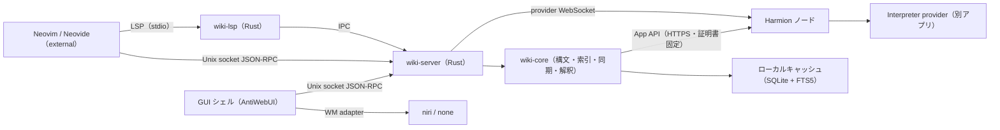

# Wiki アプリ要件定義（草案）

状態: 草案。UI の分担・スニペット変換の契機・埋め込み構文・query 構文・添付・階層・競合UXは未決。
更新日: 2026-11-22
対象: Harmion 上で動く最初の実用アプリ「Wiki」
関連: [現時点の仕様](specification.md) / [App API](app-api.md) / [Interpreter v1](../contracts/interpreter-v1.md) / [標準検索の草案](search-design.md) / [Architecture](architecture.md)

## 0. 要約

- 単一所有者の個人 Wiki。ページもスニペットも1つの Content（kind `wiki`）として保存し、ページ本文は Markdown、スニペットは任意の形式。
- **閲覧・検索・バックリンク・埋め込み・競合解決は GUI シェル**、**本文の編集は Neovim** が担当する。WebUI は fallback（§9）。
- 本文にはリンク `[[...]]`、取り込み `![[...]]`、解釈 `![provider/name(args)]` を書ける。解決結果は本文へ書き戻さない（§5）。
- **取り込んだドキュメントは、取り込み元のページから編集を開始できる**。編集は Neovim で行い、埋め込み先の Content に保存する。コピーを作らない（§5.3）。
- **`!` 付きフェンスで明示したブロックだけを自動で snippet Content に抽出し、埋め込みとして扱う**。フェンスの preset から言語と kind を決め、通常のコードブロックはインラインのまま。文書は二重に持たず、ホストページから編集できる（§5.4）。
- 解釈は Harmion の Interpreter を呼ぶ。Wiki は他の provider を呼ぶだけでなく、**自身も `wiki/backlinks` などの Interpreter を提供する**（§5.5、§5.10）。
- v1 は GUI シェル、external Neovim（Neovide / terminal）の編集、編集可能な埋め込み、スニペット、解釈の呼び出しと提供、検索、タグ、競合、エクスポート。
- v1 でやらない: 共同編集、公開サイト、バイナリ添付、WYSIWYG、過去版の閲覧UI、MCP の直接実装、Android ネイティブ。
- 最大の未決: external Neovim の統合 UX（§9）、LSP の範囲（§8.3）、スニペット正規形の運用（§5.4）、Interpreter 契約の変更範囲（§5.5）、スナップショット（§5.7）。

## 1. 目的と成功条件

Harmion の最初の実用アプリとして、日常的に使える個人 Wiki を作る。テキストを保存するだけでなく、**他のアプリの解釈を本文に埋め込み、埋め込んだ文書をその場から開いて編集できる（編集は Neovim）**ことを中核に置く。同時に、App API の Query・Subscribe・編集トークン・競合・権限・Interpreter を実地で検証する。

| # | 成功条件 |
|---|---|
| G1 | 日常のメモ・調査を Wiki に書ける（週3日以上、1日数ページ編集） |
| G2 | 2端末の並行編集で内容が消えない。すべての候補が取得でき、手動で解決できる |
| G3 | ネットワーク断が1日続いても編集でき、復帰後に両端末の変更が残る |
| G4 | 1万ページ・本文合計50MBで、起動3秒以内、検索150ms以内、ページ表示100ms以内 |
| G5 | `wiki export` したディレクトリだけで内容が読める（Harmion なしで可搬） |
| G6 | 自動マージによる意図しない消失が0件（受け入れテストで確認） |
| G7 | 解釈の埋め込みが日常的に使える。provider の未起動・タイムアウト・エラーでページ全体が壊れない |
| G8 | Neovim 上で SKK を使って日本語編集でき、入力方式を壊さない。GUI の入力欄も IME で壊れない |
| G9 | 埋め込みの結果は本文に混入しない。ソースが常に正本で、再計算・削除ができる |
| G10 | 取り込んだページ・スニペットを、取り込み元のページから編集できる。コピーが増えない |
| G11 | `!` 付きフェンスで明示した文書だけが自動でスニペットになり、preset から言語と kind が付く。ホストページから開いて編集でき、本文が二重管理されない |
| G12 | Wiki 自身が少なくとも1つの Interpreter（`wiki/backlinks`）を提供し、他アプリから呼べる。自分の UI と同じ結果を返す |
| G13 | 全件を対象にする解釈が64件で打ち切られない。契約変更後は1回の論理呼び出しで渡し、旧契約では partial を明示する |
| G14 | external Neovim（Neovide / terminal）が GUI と一貫した UX で統合される。フォーカス・保存状態・競合表示が行き来する |

## 2. 利用者・環境

- 所有者1人。共有・共同編集・公開はしない。認可は Harmion の Read/Write（kind `wiki`）に従う。
- 主端末は Linux デスクトップ。GUI シェルと external Neovim（Neovide または terminal）を並べて使う。GUI への埋め込みは v1 では行わない。
- WM は niri を想定するが、連携は任意（off 可能）。Windows は現時点で対象外。
- 日本語入力は Neovim 上では **SKK**、GUI の入力欄（タイトル・検索・タグ）は OS の IME を使う。
- 将来 Android（ノード内蔵）と Android 向け Wiki。v1 の対象外。
- 同時起動は通常1〜2台。常時接続ではない。各端末のローカルノードが書込みを受理する。
- 1ページの典型は2〜20KB。保存要求全体の上限は 1MiB（本文＋属性）。
- provider（解釈の提供元）は別アプリ、別プロセス、または Wiki 自身。常時起動を前提にしない。

## 3. スコープ

### 3.1 v1（Must）

- GUI シェル: ページ一覧、閲覧、検索、バックリンク、埋め込み表示、競合、設定（UI 分担は M0 で確定）
- external Neovim（Neovide / terminal）の統合: フォーカス、Content のオープン、保存状態、競合表示
- ページ、Wikiリンク、バックリンク
- ページ・見出しの取り込みと、取り込み元からの編集
- `!` 付きフェンスの自動スニペット化（preset から言語・kind を決定）と、ホストページから開いて編集（Neovim）
- コードスニペットの syntax highlight（`language` に応じる。未知の言語はプレーンテキスト）
- Interpreter の解釈の埋め込みと呼び出し結果の表示
- Wiki 自身の Interpreter 提供（`wiki/backlinks` / `wiki/outline` / `wiki/transclude` を Must）
- 全件解釈（Interpreter 契約の変更、ストリーミング）
- 全文検索（日本語の部分一致を含む）、タグ
- 競合の検知・比較・手動解決
- オフライン起動と購読による追従
- Markdown ディレクトリへのエクスポート

### 3.2 Should

- Neovide のウィンドウ配置・テーマの統合
- GUI と Neovide のウィンドウグループ移動・レイアウト復元（niri 連携）
- WM 連携 off / 非対応環境での手動配置
- Neovim LSP（診断・定義・参照・補完・hover、必要に応じて semantic tokens）
- ブロック単位の取り込み、snippet の name 付け
- スニペット一覧・使用箇所・format / language / kind フィルタ
- provider 一覧と引数フォーム（schema 駆動）
- 埋め込み結果のスナップショット保存
- 他形式（Markdown / Obsidian）からのインポート
- 数式、脚注、タスクリスト
- リンク切れ・孤立ページ一覧
- 複数ワークスペース（属性によるアプリ内フィルタ）

### 3.3 Could（v1後）

- WebUI（Android・共有・閲覧専用の fallback）
- MCP ブリッジ（別プロセス）
- グラフ表示、ベクトル検索
- Mermaid、添付画像、PDF/印刷
- ページテンプレート、デイリーノート
- 名前付きの解釈結果の参照（`[!name]`）
- Android アプリ（WebView 再利用または Compose）

### 3.4 Won't（v1ではやらない）

- 複数ユーザー、共有、公開 Web サイト
- リアルタイム共同編集、カーソル共有
- WYSIWYG エディタ
- バイナリ添付の Harmion 保存（§4.6）
- サーバー側全文検索（Harmion の `Search` は草案）
- アプリからの過去版閲覧・ゴミ箱（履歴 API がない）
- provider の自動起動・D-Bus 的な service activation（Harmion 側の将来機能）
- MCP を Wiki プロセス内で実装すること
- プラグイン機構、AI 生成
- Windows 版の最適化（現時点では対象外）

## 4. データモデル

### 4.1 Content への割り当て

- 1つの Content がページ・スニペット・スナップショットのいずれか。kind は `wiki`、属性の namespace は `wiki`。
- body は Markdown 本文（UTF-8、CommonMark + GFM の範囲）。リンクと埋め込みの式も body に含む。
- 再利用・解釈する非 Markdown の文書（ledger ジャーナル、コード、SQL など）は、`type=snippet` の Content として保存し、ページから埋め込む（§5.4）。小さな説明用のコードブロックは通常のフェンスとしてインラインに置ける。
- `wiki/type` でページ・スニペット・スナップショットを区別する。基本 kind は `wiki` とし、snippet はフェンス由来の追加 kind を持つ（§5.4）。
- 属性（以下 `wiki/key` は namespace `wiki` の key を表す）:

| key | 型 | 必須 | 意味 |
|---|---|---|---|
| `type` | 文字列 | ○ | `page` / `snippet` / `snapshot`。既定は `page` |
| `schema` | 整数 | ○ | スキーマ版。v1 は `1` |
| `title` | 文字列 | ○ | 表示タイトル。一意でなくてよい（§4.5） |
| `tags` | 文字列の配列 | - | 順序なし・重複なしとしてアプリが解釈 |
| `aliases` | 文字列の配列 | - | Wikiリンク解決の別名 |
| `created_at` | 整数（UTC µs） | - | アプリが初回保存時に設定 |
| `workspace` | 文字列 | - | アプリ内の絞り込み用。権限境界ではない |
| `format` | 文字列 | - | snippet の preset（`hledger` / `rust` / `ledger` など、`type=snippet`） |
| `language` | 文字列 | - | シンタックスハイライト用の言語（`hledger` → `ledger`、`type=snippet`） |
| `name` | 文字列 | - | snippet の名前（`type=snippet`） |
| `filename` | 文字列 | - | snippet の元ファイル名（任意） |

- snippet の Harmion kinds は `wiki` + フェンスで指定した kind。`hledger|ledger,free` のフェンスなら kinds は `wiki`, `ledger`, `free`。kind は所属と権限の単位で、`wiki/type` はアプリ内の分類。
- `format` はフェンスの preset、`language` はシンタックスハイライト用の言語。kind は Content の kinds であり属性ではない。

- Harmion は属性の意味を解釈しない。アプリが意味と検証を持つ。
- 未知の `wiki/*` 属性と kind は保存時に落とさない。編集は変更した項目だけを送る。
- 保存要求の上限（1MiB、本文＋属性）を超えるページは作成・保存できない。エディタで事前に上限を表示する。

### 4.2 本文の構文

- 本文の構文は、解決する3つ（リンク・取り込み・解釈）と、保存時に変換する1つ（`!` 付きフェンス）に限定する。
  - リンク `[[...]]`: 遷移。保存時に Content ID へ正規化する（§5.1）。
  - 取り込み `![[...]]`: 他ページ・見出し・ブロック・スニペットを表示時に展開する（§5.2、§5.3）。
  - 解釈 `![provider/name(args)]`: Interpreter を呼び、`display` を表示する（§5.5）。
  - 埋め込みブロック（`!` 付きフェンス）: 保存時に snippet へ変換し、正規形 `preset|kinds||id` のフェンスに置換する（§5.4）。
- いずれも **body の文字列が正本**。解決結果・計算結果は body に書き戻さない。
- 解決結果はローカルキャッシュにのみ持つ。同期・エクスポートの対象外（スナップショットを除く、§5.7）。
- 未知の構文は通常のテキストとして扱い、保存で壊さない。

### 4.3 競合単位

- body、`title`、`tags`、`aliases`、`type`、`format`、`language`、`name` はそれぞれ独立した競合単位になる。同じ保存でも項目ごとに解決され得る。
- 意味的に不可分な情報を属性へ分割しない。リンク先・埋め込み結果は body から導出し、属性に持たない。
- タイトルと本文が別端末で同時に変わると、解決後に「新しいタイトル＋古い本文」の組み合わせが生まれ得る。アプリは項目ごとに競合を表示する。

### 4.4 本文と埋め込みの関係

- ホストページの body には、取り込み先の ID と表示に必要な最小限の情報だけを持つ。
- 取り込んだ本文・文書はホストの body に複製しない。編集は取り込み先の Content に対して行う。
- したがって「ページの見た目」は複数の Content から組成される。保存・競合・エクスポートは Content 単位で扱う。

### 4.5 タイトルの一意性と重複

- タイトルは一意でなくてよい。Wikiリンクの解決で複数候補があれば選択 UI を出す。
- オフラインの2端末が同名ページを別々に作成すると、別 Content として2ページできる。Harmion はタイトルで統合しない。
- 同期後に「同名・同別名のページ」を検出し、統合を提案する（リンクの付け替え、片方の削除、別名化）。自動統合はしない。
- 重複検出はローカル索引で行い、統合はユーザーの明示操作にする。

### 4.6 添付・画像

- v1 はバイナリ添付を持たない。画像は外部 URL のみ（Should）とし、既定では自動読み込みしない。
- 理由: Harmion v1 にバイナリ保存がない、保存要求全体が 1MiB 上限、base64 埋め込みは同期・検索・可搬性を損なう。
- 端末ローカルの `assets/` に置く方式は同期されず、データが端末に閉じるため v1 では採用しない。
- Harmion にバイナリ保存が入った時点で `wiki/attachment` を設計する（§15）。

### 4.7 スキーマ版

- `wiki/schema = 1` を保存し、将来の移行に使う。
- 未知の schema 版のページは読み取り専用で表示し、保存で壊さない。未知の属性は保持する。

### 4.8 一覧での扱い

- 通常のページ一覧は `type=page` のみを出す。snippet はスニペット一覧、snapshot はスナップショット一覧に分ける。
- 検索は種類を横断してよいが、結果に種類を表示する。
- バックリンクはページ・スニペットの参照関係を別々に集計する。

## 5. リンク・埋め込み・解釈

本文の埋め込みは、単なるリンクや表示用の引用ではない。ledger のジャーナル、コード、クエリなど、**他アプリが解釈する文書**を本文の一部として置き、その場から開いて編集し（編集は Neovim）、必要なら Interpreter で解釈させる仕組みである。

| 種類 | 記法 | 実体 | その場での編集 |
|---|---|---|---|
| リンク | `[[...]]` | 既存 Content への参照 | 遷移のみ |
| 取り込み | `![[...]]` | 既存 Content（ページ・見出し・スニペット） | 可能（§5.3） |
| 埋め込みブロック | `!` 付きフェンス | 保存時に snippet 化される新しい文書 | 可能（§5.4） |
| 解釈 | `![provider(...)]` | Interpreter の計算結果 | 不可（再実行のみ） |

### 5.1 リンク

- 本文中の `[[...]]` を Wiki リンクとして扱う。
- 正規形は Content ID 参照（`[[id:<hex>|<表示名>]]`）。保存時にタイトル・別名から ID へ解決して正規化する。
  - ID 正規形の理由: タイトル変更で壊れない、同名ページを区別できる、削除・復元でも同一性が保たれる。
  - 入力は `[[タイトル]]`、`[[タイトル|表示名]]`、`[[id:...]]` を受ける。
  - 解決できない参照は未解決リンクとして保持し、新規作成を提案する。
- 表示名は表示時に現在の `title` を引く。保存時の表示名はフォールバック。
- バックリンクは本文から導出し、ローカルの索引に持つ。属性には保存しない。
- 見出しリンク `[[id:...|Title#section]]` は Should。
- 外部 URL は通常の Markdown リンク。独自スキームは本文へ埋めない（可搬性のため）。

### 5.2 取り込み（transclusion）

- ページ全体 `![[id]]`、見出し `![[id#見出し]]` を Must、ブロック `![[id#^block]]` を Should とする。
- 表示時に現在の Read 権限で解決する。読めない場合は本文を出さず「参照不可」とだけ表示する。
- 再帰は深さ3まで。循環を検出して打ち切る。1ページあたりの展開量（文字数・件数）に上限を設ける。
- オフラインでも購読キャッシュから解決できる。キャッシュにない場合はプレースホルダを出す。
- エクスポートでは既定で展開して単体で読める形にする。参照のまま出す `--raw` も用意する（§13）。
- 文芸的プログラミングのため、`!` 付きフェンスの snippet を他ページへ埋め込める（§5.4）。ブロック参照は本文の一部を指す機能として Should のまま残すが、コードの再利用は snippet を第一とする。

### 5.3 編集可能な取り込み

- **取り込まれた Content は、取り込み元のページから編集を開始できる**。編集は Neovim で行い、ユーザーは「コピーを編集している」のか「元を編集している」のかを意識しない。
- 編集は埋め込み先 Content の更新として保存する。ホストページの body は変更しない。コピーを作らない。
- 編集は、ホストページから離れずに開く隣接の Neovim で行う。GUI 内にエディタを埋め込まず、別ページへ遷移するだけの導線も不可（§16 D5）。
- 深さ1の取り込みを編集可能とする。深さ2以上の取り込みは読み取り専用とし、「ソースを開く」で編集する。
- 埋め込み先に Write 権限がない場合は読み取り専用。ロックを表示し、編集操作を無効にする。
- 同じ Content が1ページ内の複数箇所に埋め込まれる場合、編集バッファを共有し、編集を全箇所へ反映する。
- 外部更新が dirty な編集を上書きしない。更新あり・競合を表示し、ユーザーの操作で取り込む。
- 保存は Content ごとに独立。ホストページと埋め込み先を1つの更新として原子的に保存しない。成功・失敗を Content 単位で表示する。
- 新しいスニペットを参照する場合は、スニペットを作成してから参照を保存する。逆順で失敗した場合は孤児を検出し、再リンクを提案する。
- 埋め込み先が削除された場合はプレースホルダを出す。自動復元はしない。管理ツールでの復元を案内する。
- 常に「ソースを開く」操作を提供する。
- 例: ledger のジャーナルページを `![[id]]` で取り込んだページで、ジャーナルの1行を直すと、元のジャーナルページが更新される。ホストページの body は変わらない。

### 5.4 埋め込みブロックとスニペット

- 文芸的プログラミングのため、本文中に他アプリ向けの文書（コード、ledger、query など）を埋め込める。埋め込まれた文書は、ホストページ上でそのまま編集できる（§5.3）。
- 著者は **`!` 付きフェンス**（開きフェンスの直前に `!` を置く）で埋め込みブロックを書く。フェンス情報は `<preset>[|<kind>[,<kind>...]]`。
  - preset `ledger` だけを書くと、言語 `ledger`、kind `ledger` になる。
  - `hledger|ledger,free` と書くと、preset `hledger`、言語 `ledger`、kinds `ledger`, `free` になる。
  - preset は構文と既定 kind の組。`hledger` は言語 `ledger`、既定 kind `ledger` に解決する。
  - `|` 以降を書くと既定 kind を置き換える。`wiki` kind は常に付く。
  - 未知の preset は言語名をそのまま使い、追加 kind は付けない（`wiki` のみ）。

````text
!```hledger|ledger,free
2026-11-16 * 買い物
    支出:食費  1200 JPY
    資産:現金  -1200 JPY
```
````

- 保存時に `!` 付きフェンスを snippet Content へ抽出し、ホストの body を **正規形** `<preset>|<kinds>||<id>` の `!` 付きフェンスに置換する。本文は snippet 側だけに持つ。
  - preset と kinds は `|`、kinds と ID は `||` で区切る。kinds と ID を判別できる。
  - 例: `hledger|ledger,free||3f2a...`（先頭に `!` 付きフェンス）。
  - kinds が空の場合は `<preset>||<id>`。ID は32バイトの Content ID（16進64文字）。
  - 正規形のフェンスは本文を持たない。レンダラが snippet をインライン展開する。次回開いたときも同じ形で、Neovim で開いて編集できる。
  - preset と kinds がホストに残るため、シンタックスハイライトとアプリの所属が分かる。
- **コードスニペットの syntax highlight は Must**。`language` に応じた埋め込みコードの強調を表示し、未知の言語はプレーンテキストにフォールバックする。本文が読めなくなることはない。
- 変換後、エディタは正規形を表示し、文書はインラインでレンダリングする。1回の undo で戻せる（Should）。undo で戻した場合、作成済みの snippet は孤児として扱い、削除を提案する。
- 変換は可視で、取り消し・インラインへの戻しができる。`!` を外した場合は変換しない。
- snippet は kind `wiki` + フェンスの kinds。`wiki/type=snippet`、属性は `format`（preset）、`language`（ハイライト言語）、`name`、`filename`、`title`。
- **kind の付与には Write 権限が必要**。grant にない kind を含む変換は失敗し、元のフェンスをインラインのまま保持する。欠けている kind を表示し、grant の追加を促す。無言で kind を落とさない。
- Harmion の Write Filter は any-kind のため、`wiki` を含むだけで他の kind を付けられる可能性がある。アプリ側でも kind ごとの Write を検査し、プラットフォーム側の制約を要望する（§15）。
- snippet は「他アプリ向けの文書」であり、Wiki はその意味を解釈しない。ledger の残高計算などは ledger provider の責務。
- snippet の編集はホストページから開いて行う（§5.3）。スニペット一覧、使用箇所、format / language / kind フィルタ、検索を提供する。
- snippet を他のページへ埋め込むと、元の `format`/`language` のコードブロックとして表示する。二重管理しない。
- snippet を解釈の入力として provider に渡せる（Should）。たとえば ledger 向け snippet を `ledger/balance` に渡して残高を表示する。入力の指定方法は未決（§16 D20）。
- 正規形のフェンスの preset/kinds を変更すると、snippet の `format`/`language`/kinds を更新する（Should）。kind の追加は権限検査を行い、失敗時は元に戻す。
- snippet の body 競合は通常の本文競合と同じ。ホストのフェンスは変わらない。
- snippet を削除すると参照は壊れる。プレースホルダを出し、再リンクまたは管理ツールでの復元を案内する。
- snippet の作成・保存に失敗した場合、ホストの body は書き換えず、元のフェンスを保持する。文書を失わない。
- 変換の途中で失敗した場合、作成済みの snippet を孤児として検出し、再試行時に再利用する。重複 snippet を作らない。
- エクスポートは既定で本文をインライン展開し、単体で読める形にする。`--raw` では正規形と snippet を別々に出す（§13）。
- 1ページあたりの snippet 数・合計サイズに上限を設ける。超過時はインラインに戻し、警告する。
- 例: 家計のページに `hledger|ledger` の `!` 付きフェンスでジャーナルを書き、保存すると snippet になる。その snippet を `ledger/balance` に渡して残高を表示できる（D20）。

### 5.5 解釈（Interpreter call）

- 構文: `![<provider-name>(<args>)]`。provider 名は登録名で、`/` を含んでよい（例: `ledger/balance`）。
- args は `key: value` の列と `query(...)`。値は文字列・数値・真偽・日付・配列。任意コードは評価しない。
- 例: `![ledger/balance(query(before: 2026-11-16))]`
- `query(...)` は Harmion の型付き Query のサブセットに変換する。v1 で扱う条件は kind、属性の eq / exists / 大小比較 / contains、最終編集時刻の範囲。暗黙の AND とし、or / not は Could。
- 属性条件は namespace と key を指定できる。Wiki のタグは `tag:`、他アプリの属性は `attr(namespace/key) op value` のように書ける。日時はローカルタイムゾーンで解釈し、UTC µs に変換する。
- Wiki は購読キャッシュ（全 wiki Content）または Query から対象を選び、可視 Content を ID と編集トークンで `interpreter-call` に渡す。provider にはトークンも Read 権限も渡らない。
- Interpreter v1 の入力上限64件は全件解釈の妨げになるため、契約を変更する（v1 の改訂または v2）。件数上限を撤廃し、入力全体の論理上限を 128 MiB とする。Wiki は変更後の契約を前提に、全件を1回の論理呼び出しで渡す。
- 入力は v1 からストリーミングで送る（チャンク、順序、完了、キャンセル、エラー）。合計が 128 MiB を超える場合は明示エラーとする。出力は v1 では単一の `display` / `data` とし、必要なら将来ストリーミングする。
- 既存の64件以下の呼び出しは互換のまま通す。上限だけを拡張し、呼び出し側の既存実装を壊さない。
- 移行期間中に旧契約のノードへ接続した場合だけ、64件ずつバッチ＋マージし、`partial` を明示する。無言の切り捨てをしない。
- Query のページング（32件/ページ、カーソル5分）は、購読キャッシュがある通常運用では主経路ではない。全件再取得が必要な場合の制約として §15 に記載する。
- provider の default query（v1 は kinds のみ）と利用者の query を AND で結合する。呼び出し元が条件を置き換えることはしない。
- 解釈の入力に snippet を明示的に含められる（Should）。ledger 向け snippet を `ledger/balance` に渡す、など。Query の結果と明示入力の結合方法は未決（§16 D20）。
- 出力は `display` を描画する。`data` は v1 では表示に使わない（デバッグ表示は Should）。
- `display` の許可 media type は `text/markdown`、`text/plain`、`application/json`。それ以外はプレーンテキストとして型名付きで表示する。HTML は許可しない。
- provider のエラーは code と message をインライン表示する。ページ全体を失敗させない。

| 状態 | 表示 |
|---|---|
| loading | プレースホルダと経過表示 |
| ok | display と取得時刻・provider 名 |
| stale | 前回の display と「古い」表示、再実行ボタン |
| unavailable | provider 未接続。起動を促す。自動起動はしない |
| timeout | タイムアウト。再試行 |
| capacity | 同時実行上限。待機・再試行 |
| provider error | code / message。詳細はログへ |

- 同時実行はノード全体32件、アプリ8件。Wiki 側でもキューを持ち、画面外の埋め込みは遅延実行する。
- タイムアウトは既定10秒、埋め込みごとに指定できる（100〜30,000ms）。ページを閉じたら cancel する。
- 呼び出しは冪等ではない。再送で別の結果になり得ることを前提に、表示は「取得時点の結果」として扱う。

### 5.6 キャッシュと無効化

- 埋め込み結果はローカル DB にキャッシュする。キーは provider 登録版、正規化した args、query 結果の Content 版、Wiki のスキーマ版。
- 既定は stale-while-revalidate。ページを開くとキャッシュを即表示し、裏で再計算する。
- TTL と手動更新を用意する。埋め込み単位で再実行できる。
- 入力 Content の upsert / remove、provider の再登録・承認変更、grant 変更で無効化する。権限外になった内容のキャッシュは削除する。
- キャッシュは同期しない。エクスポートにも含めない。サイズ上限と LRU を持つ。
- オフラインではキャッシュがあれば stale として表示し、なければ unavailable にする。呼び出しでページ表示をブロックしない。

### 5.7 名前付き結果とスナップショット（Should / Could）

- ページ内で解釈結果に名前を付け、複数箇所から参照する `[!name]` は Could。v1 は同一式のキャッシュ共有で代替する。
- 結果を Content として保存する「スナップショット」は Should。provider 名、args、入力 Content の版、取得時刻を provenance として持つ。本文とは別の Content（`type=snapshot`）とし、本文へは参照だけを書く。
- ハッシュ付きの値参照（初期構想の `[hash|today.balance]`）は、このスナップショットの同一性・監査の将来形として扱う。v1 では取得時刻と provider 版の表示に留める。

### 5.8 表示・編集・エラー

- ソースは常に編集可能。レンダリングはプレビューまたは仮想行で行い、ソースを書き換えない。
- 埋め込みから「ソースへ移動」「再実行」「無効化（コメントアウト）」ができる。
- 編集可能な埋め込みは、読み取り専用の埋め込みと見た目で区別する（ロック、境界、フォーカス）。
- エラーはインラインで code と短い説明を出し、詳細はログ・診断パネルへ送る。
- `display` は untrusted。Markdown の HTML は無効、許可制でサニタイズする。外部リソースは読み込まない。表示内のリンクは自動で開かない。
- ログに args と結果を既定で出さない（機密が含まれ得る）。

### 5.9 provider の可用性とライフサイクル

- provider の登録・承認はノードローカル。クラスタ全体で使えることを保証しない。端末ごとに「使える / 使えない」を表示する。
- v1 は自動起動しない。未接続なら unavailable と起動の案内を出す。D-Bus 的な service activation は Harmion の将来機能として要望する（§15）。
- Wiki は `call` と `provide` を要求する。`provide_names` に `wiki/backlinks` / `wiki/outline` / `wiki/transclude` を含め、統合接続の承認で provider 登録も確定する。`provide` は Read/Write を含意しない。
- grant は `read:kind:wiki`、`write:kind:wiki`、snippet で使う kind の write、`call`、`provide`（`provide_names`）を含む。snippet の追加 kind は設定で許可したものだけを使う。
- provider の一覧・説明・入出力 schema・default query・接続状態は `interpreter-list` / `interpreter-describe` から取得する。
- 引数フォームを schema から生成するのは Should。v1 は手書きの引数と補完でよい。
- MCP は v1 では Wiki が直接話さない。解釈の呼び出し経路は Harmion の Interpreter に一本化する。外部エージェント向けの MCP ブリッジは別プロセスで将来検討する。

### 5.10 Wiki が提供する Interpreter

- Wiki は解釈の消費者であるだけでなく、提供元にもなる。`provide` 権限と `provide_names` を持ち、統合接続の承認で provider 登録も確定する。
- provider は `wiki-server` 内のループとして動き、ノードへアプリ資格情報付きの WebSocket で attach する。入力は呼び出し元が渡した Content スナップショットだけで、Wiki 自身の Read/Write を provider に使わせない。書き込みもしない。
- 候補:

| 名前 | 入力 | 出力 | 優先 |
|---|---|---|---|
| `wiki/backlinks` | wiki Content 群、対象 ID / タイトル | 被リンク元、リンク切れ | Must |
| `wiki/outline` | ページ本文 | 見出し・目次 | Must |
| `wiki/transclude` | ページと参照先 Content | 展開済みテキスト | Must |
| `wiki/graph` | wiki Content 群 | ノード・エッジ | Could |

- v1 は `wiki/backlinks`、`wiki/outline`、`wiki/transclude` を `provide_names` に入れる。backlinks は Wiki のバックリンク panel と同じ実装を使い、内部呼び出しと provider 経由の結果が一致することをテストする。provider 名の追加は grant 変更として所有者の承認が要る。
- `wiki/lint` は v1 の provider に含めない。リンク切れ・孤立ページは UI のローカル索引で計算する。
- `wiki/transclude` は、対象ページと参照先（取り込み・スニペット）の Content をすべて受け取り、展開済みテキストを返す。参照の再帰は深さ3までとする。
- default query は `{"kinds":["wiki"]}`。契約変更後はストリーミングで全件を1回の論理呼び出しとして処理する（§5.5）。旧契約のノードでは部分結果を `partial` として返し、呼び出し側がマージする。
- provider の登録名は承認済みで一意。同名の別 provider は所有者の明示的な置換が要る。
- ライフサイクルは `wiki-server` に従う。server が落ちると provider も unavailable。自動起動はしない。
- `provide` は Read/Write を含意しない。provider は渡されたスナップショットだけを計算し、ID から取り直さない。
- 他のアプリが Wiki の解釈を使う例: ledger アプリが `wiki/backlinks` で関連ページを出す、など。
- Wiki 自身の UI は内部実装を既定にし、provider 経由のセルフテストを用意する（Should）。結果が一致しなければ provider の不具合として扱う。

### 5.11 初期構想との対応

| 初期構想 | 本要件での扱い |
|---|---|
| テキストのオブジェクトストレージ | Content（kind `wiki`）と body |
| 解釈の管理、Capacity | Interpreter の登録・発見と呼び出し（§5.5） |
| `![ledger/balance(query(...))]` | 解釈の埋め込み（§5.5） |
| `[hash\|today.balance]` / `[!今の資産]` | スナップショット・名前付き参照（§5.7、Should / Could） |
| コード／ledger などの文書の埋め込み、文芸的プログラミング | 埋め込みブロック（§5.4）と取り込み（§5.2） |
| `!` 付きフェンスによる自動スニペット化 | §5.4 |
| preset からの言語・kind の決定 | §5.4（`hledger` → language `ledger`、`hledger\|ledger,free` → kinds `ledger,free`） |
| Wiki 自身の解釈提供 | §5.10（`wiki/backlinks` など） |
| D-Bus 的な service activation | v1 は手動起動。Harmion への要望（§15） |
| MCP で外部連携 | 別プロセスのブリッジ。v1 対象外（§5.9） |
| hledger・OCR・takusu | provider 側の責務。Wiki は解釈を呼ぶだけ |
| 属性の `kind:` 接頭辞による分類 | 現行仕様の namespace / key を使う（§4.1） |
| Android の Intent / ContentProvider | 将来の OS 統合。v1 対象外 |

## 6. 機能要件

| ID | 要件 | 優先 | 受け入れ条件 |
|---|---|---|---|
| FR-01 | GUI でページ一覧・最近更新・タイトル順・タグを表示 | Must | 1万ページで初期表示500ms以内（キャッシュ） |
| FR-02 | GUI でページを閲覧。見出し・リスト・表・コード・引用を描画 | Must | 代表的な Markdown が崩れない |
| FR-03 | 目次、見出しアンカー、コードハイライト | Must | 長いページで目次から移動できる |
| FR-04 | Neovim でフォーカス中の Content を編集 | Must | 100KB のページで入力が破綻しない |
| FR-05 | 自動保存（停止後1.5秒）と明示保存（`:w`） | Must | 保存状態が常に分かる |
| FR-06 | request_id による冪等保存、失敗時の再試行 | Must | 二重保存・二重作成が起きない |
| FR-07 | 編集中バッファのローカル下書きとクラッシュ復旧 | Must | 強制終了後に本文が戻る |
| FR-08 | SKK（Neovim）と IME（GUI 入力欄）を妨げない | Must | 変換が途切れず、キーマップが誤発火しない |
| FR-09 | 新規作成、タイトル変更、タグ編集、削除 | Must | 各操作が他項目を壊さない |
| FR-10 | Wikiリンクの補完・解決・未解決リンクからの作成 | Must | `[[` で候補が出る |
| FR-11 | バックリンク一覧 | Must | 本文変更が索引へ反映される |
| FR-12 | ページ・見出しの取り込み | Must | 参照先の変更が表示に反映される |
| FR-13 | 取り込んだ Content をホストページから編集 | Must | 保存先が埋め込み先になり、コピーが増えない |
| FR-14 | 複数箇所の同一埋め込みを1つのバッファで編集 | Must | 編集が全箇所へ反映される |
| FR-15 | `!` 付きフェンスの自動スニペット化（preset から言語・kind を決定） | Must | 保存後に snippet ができ、本文が二重化しない |
| FR-16 | スニペットをホストページから開いて編集（Neovim） | Must | 保存先が snippet になる |
| FR-17 | スニペット一覧・使用箇所・format / language / kind フィルタ | Should | 参照関係が分かる |
| FR-18 | 解釈の埋め込み（呼び出し・表示・再実行） | Must | provider 未起動でもページが壊れない |
| FR-19 | 埋め込み結果のキャッシュ、stale 表示、無効化 | Must | オフラインで前回結果を読める |
| FR-20 | provider 一覧と接続状態の表示 | Must | 端末ごとの可用性が分かる |
| FR-21 | 全文検索（タイトル・本文・タグ・別名・スニペット） | Must | 1万ページで150ms以内、日本語2文字語を拾う |
| FR-22 | タグ一覧、タグ絞り込み、タグページ | Must | タグ変更が一覧へ反映される |
| FR-23 | 起動時にキャッシュ表示、購読で追従 | Must | オフラインでも直前の内容を読める |
| FR-24 | 接続・購読・未送信・競合・埋め込みの状態表示 | Must | 状態を取り違えない |
| FR-25 | 競合の項目別表示、比較、手動マージ、選択保存 | Must | 両候補が消えず、解決後も未確認更新を消さない |
| FR-26 | 削除の確認と、復元は管理ツールへ誘導 | Must | 誤削除を即座に取り消せないことを明示 |
| FR-27 | Markdown ディレクトリへのエクスポート | Must | 出力だけで内容が読める。再実行が決定的 |
| FR-28 | GUI にエディタを埋め込まない。編集は external Neovim | Must | GUI は閲覧・組成・フォーカスに限定される |
| FR-29 | ブロック参照（本文の一部を指す） | Should | コードの一部を別ページから取り込める |
| FR-30 | schema 駆動の引数フォーム | Should | provider の入力を UI で組み立てられる |
| FR-31 | 埋め込み結果のスナップショット | Should | provenance 付きで保存・参照できる |
| FR-32 | 数式、脚注、タスクリスト | Should | 代表的な記法が表示できる |
| FR-33 | リンク切れ・孤立ページ一覧 | Should | 索引から導出できる |
| FR-34 | 複数ワークスペース | Should | 属性フィルタで切り替えられる |
| FR-35 | インポート（Markdown、frontmatter） | Should | 再インポートで重複を作らない |
| FR-36 | 名前付き解釈結果の参照（`[!name]`） | Could | 同一ページ内で結果を再利用できる |
| FR-37 | `!` フェンスの preset から言語・kind を決定 | Must | `ledger` → kind `ledger`、`hledger\|ledger,free` → language `ledger` / kinds `ledger,free` |
| FR-38 | 正規形 `preset\|kinds\|\|id` の生成と、再オープン時の編集（Neovim） | Must | 次回開いても同じ形で編集できる |
| FR-39 | snippet の kind 付与時の Write 権限検査 | Must | 権限不足ならインライン保持し、欠けた kind を表示する |
| FR-40 | Wiki 自身の Interpreter 提供（`wiki/backlinks` / `wiki/outline` / `wiki/transclude`） | Must | 他アプリから呼べる。UI と結果が一致する |
| FR-41 | ストリーミングで全件を1回の論理呼び出しとして渡す（上限128 MiB） | Must | 1万件・50MBでも無言の打ち切りがない |
| FR-42 | external Neovim（Neovide / terminal）の統合 UX | Must | フォーカス・保存状態・競合が行き来する |
| FR-43 | provider 登録名の一意性と置換承認 | Must | 同名の別 provider を所有者が明示的に置換できる |
| FR-44 | provider のセルフテストと内部実装とのパリティ | Should | 結果の不一致を検出できる |
| FR-45 | `wiki-lsp` の起動と仮想 URI `wiki://<id>` | Should | Neovim 0.10 以降でページを開ける |
| FR-46 | LSP の diagnostics / definition / references | Should | 未解決リンク・バックリンク・参照先へ移動できる |
| FR-47 | LSP の completion / hover | Should | `[[` と `![` で候補、hover で schema が出る |
| FR-48 | LSP の code actions / document symbols / inlay hints | Could | ページ作成・snippet 化・一覧が動く |
| FR-49 | LSP 停止時の縮退 | Must | 編集・保存・検索は継続し、データを失わない |
| FR-50 | GUI と Neovide のウィンドウグループ移動・リサイズ | Should | niri でまとめて移動できる |
| FR-51 | WM 連携の off / 非対応環境 | Must | off でも RPC のフォーカス・オープンは動く |
| FR-52 | レイアウトプリセットの保存・復元 | Should | 横並び / GUI のみ / エディタのみ |
| FR-54 | wiki 固有構文の semantic tokens（必要に応じて） | Could | canonical fence / provider / kind が強調される |
| FR-55 | コードスニペットの syntax highlight | Must | `language` に応じて強調され、未知の言語でも本文が読める |

## 7. 非機能要件

| 区分 | 要件 |
|---|---|
| 性能 | 1万ページ・50MBで、起動3秒（キャッシュ）、ページ組成100ms、検索150ms、保存応答50ms（Content 単位、ローカル）、入力遅延 p95 16ms |
| 資源 | 常駐メモリ500MB以下、索引とキャッシュを含むディスク使用量は本文の3倍以下を目標 |
| 信頼性 | 保存は Content 単位のローカル永続化の成功で確定。キャッシュ破損で本文を失わない。下書きはクラッシュ耐性を持つ。埋め込みの失敗は本文を壊さない |
| 一貫性 | 結果整合。競合は必ず表面化させ、自動で捨てない。LWW の無言適用をしない。埋め込み結果は派生データとして扱う |
| 複数 Content の保存 | ホストと埋め込み先を原子的に保存しない。部分成功を明示し、失敗した Content の編集を保持する。成功した Content を巻き戻さない |
| 全件性 | Interpreter 契約を変更し、ストリーミングで全件を1回の論理呼び出しとして渡す（上限128 MiB）。旧契約では partial を明示し、無言の切り捨てをしない |
| provider 提供 | `wiki-server` の provider ループは attach を維持し、切断時は unavailable を返す。二重登録・同名の衝突を起こさない |
| UI の一貫性 | external Neovim と GUI で、フォーカス・保存状態・競合・テーマが一致する。同じ Content の二重バッファを作らない |
| WM 非依存 | niri 連携は任意。off / 非対応 WM でも、RPC のフォーカス・Content オープン・保存は動く |
| UI デザイン | ダーク固定。4カラム + リンク/情報の2モードインスペクタ + 下部2-hopシェルフ。docs/wiki-ui-design.html で凍結 |
| 可用性 | provider の未起動・タイムアウト・容量超過・エラーでも、ページの閲覧と編集は継続できる。オフラインではキャッシュを stale 表示する |
| LSP の可用性 | LSP が無い / 落ちた場合も、プラグインの RPC で編集・保存・検索を継続する。診断と補完だけを止める |
| セキュリティ | Markdown と provider display の HTML は既定で無効、許可制でサニタイズ。外部リソースは既定で読み込まない。トークンは wiki-server だけが持ち、URL・ログへ出さない。キャッシュと下書きは 0600 のアプリ専用領域 |
| プライバシー | テレメトリなし。外部画像は明示操作で読み込む。埋め込みの args と結果を既定でログに出さない。provider は所有者が承認したものだけ |
| アクセシビリティ | 全操作をキーボードで実行可能。Neovim のキーマップと SKK を尊重。GUI はフォーカス可視・文字拡大・スクリーンリーダーを考慮 |
| 国際化 | 日本語 UI を先に。UTF-8、IME、全角半角、NFKC 正規化。日時はローカルタイムゾーンで表示し、保存は UTC µs |
| 可搬性 | 標準 Markdown＋frontmatter で取り出せる。埋め込み式は文字列として残る。アプリ固有 DB がなくても本文は読める |
| 互換性 | App API v1 の capabilities を確認し、Interpreter 非対応・grant 不足なら埋め込みだけを無効化して起動する。未知の属性・kind を保持する |
| 保守性 | コア（データ・索引・同期・解釈）と UI を分離。IPC は版付き。UI を差し替えられる |

## 8. UI/UX 要件

参考にする体験:

- Obsidian: ローカルファイル感、バックリンク、クイックオープン、埋め込み、グラフ、タグ。
- Scrapbox: フラットなページ、リンク補完、2-hop リンク、インクリメンタル検索、プロジェクトの流れ。
- 共通して、**GUI は読む・探す・つながりを見る画面**にする。本文の編集は Neovim に分離し、GUI にエディタを埋め込まない。タイトル・タグ・プロパティなど最小限の入力だけを GUI に置く。
- その画面で編集しないことが、この Wiki の面白さになる。編集したいときは、同じ Content を隣の Neovide で開く。
- UI は [wiki-ui-design.html](wiki-ui-design.html) で凍結する。実装しながら余白・密度を磨くが、レイアウトと操作の方針は変えない。
- ショートカットは Ctrl 系で表示する（`Ctrl+K` 検索、`Ctrl+E` Neovide、`Ctrl+I` 情報、`Ctrl+N` 新規、`Ctrl+P` クイックオープン、`Ctrl+W` タブを閉じる、`Ctrl+1`/`Ctrl+2` でインスペクタ切替、`Ctrl+Alt+L` で 2-hop 全表示）。

### 8.1 GUI シェル

- 左: ページ一覧、スニペット一覧、タグ、検索、ワークスペース。
- 中央: ページの組成表示。本文と埋め込みを1つの読み物として表示する。
- 右: 目次、バックリンク、参照関係、競合、provider の状態。
- 下または横: external Neovim（Neovide / terminal）を別ウィンドウで並べる。GUI 内にはエディタを埋め込まない（§9）。
- 本文・埋め込みをクリックすると、その Content が編集ペインでフォーカスされる。ページから離れない。
- 取り込みは読み取り専用部分と編集可能部分を視覚的に区別する。編集可能部分にはロック解除、境界、フォーカス表示を出す。
- スニペットは元の `format` / `language` のコードブロックとして表示し、kinds・名前・使用箇所を示す。クリックで編集ペインに開く。
- 正規形のフェンス（`preset|kinds||id`）はインラインで本文を展開し、Neovim で開いて編集できる。次回開いたときも同じ形で復元する。
- Neovide のウィンドウは WM のルールで配置し、GUI の選択に合わせてフォーカスを移す。テーマを揃える。
- GUI と Neovide は1つのウィンドウグループとして移動・リサイズできる。niri ではカラム / ワークスペースの操作、他の WM では OS のウィンドウ操作を使う。
- レイアウトプリセット（横並び / GUI のみ / エディタのみ）を保存・復元する。
- 見た目は [wiki-ui-design.html](wiki-ui-design.html) で凍結。ダーク、4カラム、右は「リンク」「情報」の2モード。M7 は実装上の磨き込み。
- 保存状態は Content ごとに出す。ホストと埋め込み先を混ぜて「保存済み」と表示しない。
- タイトル・検索・タグ・プロパティなどの入力欄は OS の IME に対応する。
- キーボード: `Ctrl/Cmd+K` パレット、`Ctrl/Cmd+P` クイックオープン、`Ctrl/Cmd+S` 全 dirty 保存、`Esc`。主要操作にショートカット。
- テーマはダークを既定。管理 UI と方向性を揃える。

### 8.2 Neovim 編集（external）

- 1回に1つの Content を編集する。ページ本体か、フォーカスした埋め込み先か。
- Neovim はソース（`!` 付きフェンスを含む）を編集し、埋め込みの展開表示は GUI が担う。Neovim 内での仮想行展開は Should。
- GUI で埋め込みをクリックすると、その Content が Neovim に開く。ホストページから離れない。
- 既存の Neovide / Neovim インスタンスに `--servername` と RPC で Content を開く。新しいウィンドウや重複バッファを増やさない。
- フォーカスは双方向に同期する。GUI で選択した Content が Neovim のカレントになり、Neovim で切り替えた Content が GUI で強調される。
- 保存状態・競合・埋め込みエラーを GUI と Neovim の両方に出す。テーマとフォントを揃える。
- `buftype=acwrite`、`BufWriteCmd` で `wiki-server` に保存する。ファイルとしては保存しない。
- `:WikiOpen`、`:WikiNew`、`:WikiSave`、`:WikiFollow`、`:WikiBacklinks`、`:WikiPreview`、`:WikiEmbedRefresh`、`:WikiSnippet` など。
- リンクは extmark で強調し、`<CR>` / `gd` で遷移する。`[[` でタイトル・別名を補完する。
- 検索・一覧は GUI 側を主とし、Neovim からは `:WikiSearch` で GUI の検索を開く（または picker）。
- SKK の入力方式を尊重する。インサートモードのキーを奪わない。ノーマルモードのキーマップだけを設定する。
- dirty なバッファを外部更新で書き換えない。競合・更新ありを sign / statusline で示す。
- `:checkhealth wiki` で server 接続、購読、索引、provider の状態を確認できる。
- Neovim を再起動しても、最後に開いていた Content を復元する。GUI 側の選択と一致させる。
- WM 連携は任意。`wm = auto | niri | none`。off でも RPC のフォーカス・オープンは動く。
- niri では GUI と Neovide を同じカラム / 隣接カラムに置き、まとめて移動する。

### 8.3 Neovim LSP（Should）

- プラグインはバッファ・保存・コマンド・GUI 連携を担当し、言語機能は LSP に分離する。同じ機能を二重実装しない。
- `wiki-lsp` は stdio の LSP サーバー。`wiki-core` を再利用し、`wiki-server` の IPC に接続して索引・リンク解決・バックリンクを引く。
- 仮想ドキュメント URI は `wiki://<content-id>`。プラグインが `BufReadCmd` で開き、filetype はページなら markdown、snippet なら `language` に合わせる。LSP の document selector は scheme `wiki`。
- プラグインが `vim.lsp.start` で `wiki lsp --stdio` を起動する。LSP が無い場合もプラグインは動く。
- LSP の MVP（Should）:
  - diagnostics: 未解決リンク、壊れた埋め込み、重複タイトル、正規形フェンスの不整合、kind の Write 不足
  - definition: `[[...]]` / `![[...]]` の参照先へ
  - references: バックリンク（`gr`）
  - completion: `[[` のタイトル・別名、`![` の provider 名、`!` フェンスの preset、`|` の kind
  - hover: ページの抜粋、snippet の format / language / kinds、provider の schema
  - syntax highlight: コードスニペットは Must。treesitter で Markdown と埋め込みコードを強調し、未知の言語はプレーンテキストにフォールバックする。wiki 固有の `preset|kinds||id`、provider 名、kind、リンク ID は、必要に応じて LSP semantic tokens で補う（Should / Could）
- Should:
  - code actions: 未解決リンクからページ作成、選択範囲を snippet 化、埋め込み再実行、kind 追加
  - document symbols: 見出し・埋め込み
  - workspace symbols: ページ・snippet 検索
  - inlay hints: バックリンク数、埋め込みの stale / error
- Could: code lens、formatting、rename。semantic tokens は wiki 固有構文の補助として必要に応じて追加し、初期は treesitter を優先する。
- LSP が無い / 落ちた場合: バッファ編集・保存・検索はプラグインの RPC で継続する。diagnostics と補完だけ落ちる。データを失わない。
- LSP は保存・書き込みを行わない。保存はプラグインの `BufWriteCmd` → `wiki-server`。LSP は診断とナビゲーションに限定する。
- 保存後の正規形変更（`!` フェンス）は、プラグインが保存応答を適用してから LSP に `didChange` を送る。LSP からの `workspace/applyEdit` と二重適用しない。
- 新規ページは一時 URI（`wiki://new/<uuid>`）で開き、保存で Content ID の URI に切り替える。
- 対象は Neovim 0.10 以降。VS Code 等は将来。LSP はエディタ非依存なので再利用できる。

### 8.4 共通の状態表示

- 空・読込中・オフライン・保存中・保存済み・未同期・競合・埋め込みエラーを区別する。
- 失敗時は入力中の本文を失わない。再試行・コピー・下書き保存の導線を出す。
- 削除はタイトル入力または明示確認。復元できないことを説明する。

### 8.5 WebUI（fallback）

- Android の WebView、共有用の閲覧専用、環境構築なしの確認用に留める。
- v1 の主 UI にはしない。

## 9. UI方式の選択

### 9.1 前提

- 編集は Neovim の方が強い。SKK・キーバインド・プラグイン資産をそのまま使える。
- 閲覧・検索・バックリンク・埋め込み・競合解決は GUI の方が強い。Neovim だけでは読み物として弱い。
- したがって **GUI を主画面、Neovim を編集面**とする分担を第一候補にする。

### 9.2 候補比較（暫定）

| 軸 | WebUI | Neovim のみ | GUI + Neovim | 純 GUI |
|---|---|---|---|---|
| 編集・SKK | ○ | ◎ | ◎ | △ |
| 閲覧・プレビュー | ◎ | △ | ◎ | ◎ |
| 埋め込みの表示・編集 | ◎ | △ | ◎ | ○ |
| スニペットの閲覧・編集導線 | ◎ | △ | ◎ | ○ |
| Android 再利用 | ◎ WebView | × | △ コア共有 | × |
| 実装コスト | ○ | ◎ | △ | △ |
| 配布・起動 | △ | ◎ | ○ | ○ |
| キーボード操作 | ○ | ◎ | ◎ | ○ |
| 総合（v1） | fallback | 単独では不足 | 第一候補 | 不採用 |

- GUI + Neovim は編集体験と閲覧体験を両立できる。実装コストは高い。
- Neovim のみは編集は最強だが、閲覧・埋め込み編集・スニペット管理が弱い。
- 純 GUI はエディタを再実装することになり、SKK と編集資産を失う。
- WebUI は CodeMirror 6 の実績はあるが、日常の編集体験と配布で劣る。

### 9.3 推奨: GUI 主 + external Neovim

- **v1**: GUI シェル（AntiWebUI 第一候補、gpui 対抗）＋ `wiki-server`。編集は external Neovim（Neovide または terminal）に任せる。
- GUI がページを組成し、編集対象の Content を Neovim で開く。埋め込みをクリックすると、その Content が Neovim に開く。
- Neovide は外部ウィンドウとして起動し、RPC で Content を開き、WM の配置・フォーカス機能で GUI と一体化する。niri を第一候補とし、off / 他の WM ではフォールバックする。
- GUI と Neovide を1つのウィンドウグループとして移動・リサイズし、レイアウトプリセットを復元する。
- 一貫した UX の必須条件: フォーカスの双方向同期、同じ Content の二重バッファ禁止、保存状態・競合の共有、テーマの一致、最後に開いた Content の復元、ウィンドウ配置の記憶。
- UI の確定版: [wiki-ui-design.html](wiki-ui-design.html) / [wiki-ui-design.png](wiki-ui-design.png)。GUI と Neovide を WM でタイルし、同じ Content を共有する。
- **LSP**: プラグインの言語機能は `wiki-lsp` に分離する。MVP は diagnostics / definition / references / completion / hover。M2.5 に入れる。
- **WebUI**: Android・共有・閲覧専用の fallback として保留。
- 理由: 閲覧と編集の強みをそれぞれ活かせる。サーバーを分離すれば UI の追加・差し替えができる。

リスク: GUI ツールキットの成熟度、Neovide とのフォーカス・バッファ同期、niri 依存の配置（off 可能にする）、実装量。

### 9.4 決定ゲート（M0）

- AntiWebUI と gpui で、ページ組成・埋め込み表示・Neovide 起動・フォーカス同期のプロトタイプを作る。
- external Neovide を `--servername` と RPC で制御し、SKK と IME が壊れないか確認する。niri で GUI と Neovide のグループ移動・フォーカスを試し、`wm = none` でも基本動作することを確認する。
- GUI 内への `nvim --embed` は行わない。external を前提にする。
- 判定: 日本語入力、ページ組成の性能、フォーカス同期の一貫性、実装コスト。
- どちらかのツールキットが明確に優位なら確定する。差が小さければ AntiWebUI を第一候補のまま進める。
- GUI が間に合わない場合の fallback は Neovim プラグイン単独。ただし閲覧体験の不足を許容する。

## 10. アーキテクチャ要件



- `wiki-core`（Rust）: スキーマ、Markdown 解析、リンク・埋め込みの解決、スニペット抽出、query 変換、索引、購読、保存、競合、エクスポート。UI に依存しない。
- `wiki-server`（Rust）: App API クライアント、資格情報、IPC、購読、Interpreter 呼び出し、キャッシュ、索引、自身の provider ループ。**トークンを持つのはここだけ**。
- `wiki-gui`（AntiWebUI）: ページ組成、閲覧、検索、バックリンク、埋め込み表示、競合、設定。WM adapter を持ち、`wm = auto | niri | none` を選ぶ。niri ではグループ移動・配置・フォーカス、off / 他の WM では OS のウィンドウ操作に任せる。RPC のフォーカス同期は WM に依存しない。
- `wiki.nvim`（Lua）: バッファ、コマンド、extmark、保存。薄いクライアント。
- `wiki-lsp`（Rust）: stdio の LSP サーバー。`wiki-core` を再利用し、`wiki-server` の IPC から索引・リンク解決・バックリンクを引く。保存はせず、診断とナビゲーションに限定する。トークンを持たない。
- external Neovim: GUI が `nvim --listen` / `--servername` で起動するか、既存の Neovide / Neovim に接続する。フォーカスする Content は server 経由で通知する。WM adapter が使える場合はグループ移動・配置・フォーカスを行い、使えない場合は手動配置でも動く。
- GUI 内への Neovim 埋め込みは行わない。external のみ。
- provider ループ: `wiki-server` がノードへ WebSocket で attach し、`wiki/backlinks` などの呼び出しを処理する。provider は渡されたスナップショットだけを計算し、DB へ書き込まない。
- キャッシュ: SQLite（WAL）に購読スナップショット、下書き、索引、埋め込み結果を持つ。ノード DB は直接触らない。
- IPC: Unix domain socket（0600）または stdio。既定で TCP を開かない。ピアの OS 資格情報を検査する。プロトコルは版付き JSON-RPC。
- 起動: ユーザーごとに `wiki-server` を1つ。GUI/Neovim が接続し、なければ起動する。
- 配布: `wiki` バイナリ（server / CLI）＋ GUI バイナリ＋ Neovim プラグイン。
- Android: `wiki-core` を cross-compile し、アプリ内ノードと同じプロセス圏で動かす。UI は WebView または Compose。IPC の代わりにプロセス内呼び出しにする（§15）。

## 11. 同期・競合の要件

- 購読条件は kind `wiki`。Read filter は `read:kind:wiki`（権限が all なら all）。snippet の追加 kind は Write 権限と設定の許可 kind に従う。
- snippet に付ける kind は、Wiki の Write 権限にあるものだけ。grant と設定の許可 kind を一致させ、権限外の kind は変換を失敗させる（§5.4）。
- Wiki 自身の provider 登録はノードローカル。各端末で承認が必要で、クラスタ全体の可用性を保証しない。
- 起動時はローカルキャッシュを即表示し、`subscribe` の初期スナップショットで追いつく。初期取得中の内容は仮状態として扱い、完了後に確定する。
- ノードが起動していない場合はキャッシュを読み取り専用で表示し、接続を再試行する。未保存の下書きは失わない。
- 再開カーソルを永続化する。`reset_required` では初期取得をやり直す。資格情報の失効では購読を終了し、再認可を促す。
- 保存は編集トークン + request_id。Content ごとに独立。デバウンス1.5秒、`:w` で即時。同じ request_id の再送は同じ結果になる。
- ホストページと埋め込み先は別の Content として保存する。1つの更新で原子的に保存しない。成功・失敗を Content 単位で表示し、失敗した編集を保持する。
- `410 token_expired` では本文を保持したまま get し直し、新しい編集元で再保存する。古いトークンへ差し替えない。
- 保存応答が `view: null` と `view_error: "response_too_large"` でも、保存自体は成功として扱う（HTTP 200）。
- 競合は Content と項目の単位で `get_conflicts` から取得し、候補を並べて比較する。3-way マージの共通祖先は一般アプリに公開されないため、v1 は2-way diff＋手動編集＋`resolve` とする。
- 解決では、確認した候補だけを `replaces` に入れる。未確認の並行更新を消さない。
- 削除と編集が競合した場合は生存側を表示し、競合として通知する。アプリからは削除競合の解決・復元ができないため、管理ツールへ誘導する。
- 同じ Content を複数の編集エディタで開かない。server が開いているエディタを追跡し、2つ目には読み取り専用または警告を出す。強制編集は許可するが、保存時に競合として扱う。閲覧専用の GUI はこの制限に含めない。
- 購読の upsert / remove はキャッシュと索引に反映する。dirty なバッファと編集中の編集元は差し替えない。
- 埋め込みキャッシュは、入力 Content の変更・provider の再登録・grant 変更で無効化する（§5.6）。権限外になった内容のキャッシュは削除する。
- 同期後に同名ページの重複を検出して統合を提案する（§4.5）。自動では統合しない。

## 12. 検索・索引の要件

- 対象は `title`、`aliases`、`tags`、本文（リンク・埋め込みの式を含む）、スニペットの本文と `format` / `language` / kinds。取り込みで展開された内容と解釈結果は既定で索引しない（重複・古い結果を避ける）。索引する場合は設定で明示する。
- ページとスニペットを区別して検索できる。既定は両方、ページ一覧は `type=page` のみ。format / language / kind で絞り込める。
- 日本語の部分一致のため、SQLite FTS5 の trigram を第一候補にする。2文字語は trigram で拾えないため、bigram または LIKE のフォールバックを併用する。
- NFKC 正規化、大小文字の畳み込み、全角半角の同一視を行う。索引と検索で同じ正規化を使う。
- 順位はタイトル・別名の一致を本文より重視し、次に更新時刻で決める。同順位は Content ID で決定的にする。
- 抜粋は一致箇所の周辺を返し、ハイライトする。
- 索引は派生データ。バージョン・トークナイザ設定を保存し、不一致なら再構築する。破棄しても本文は失われない。
- 購読の upsert / remove で差分更新する。権限変更で読めなくなった内容は索引から削除する。
- バックリンク、埋め込み元、スニペットの使用箇所の索引も同様に差分更新する。
- セマンティック検索は v1 では扱わない。Interpreter の埋め込み Provider として将来検討する。

## 13. エクスポート・インポート

出力例:

```text
wiki-export/
  manifest.json
  pages/
    2026-11-22-example-title-3f2a1c9d.md
  snippets/
    ledger-example-8a1b2c3d.ledger
    rust-example-4d5e6f7a.rs
  README.md
```

- 既定は「単体で読める」出力。取り込みとスニペットを展開し、相対リンクを張る。解釈結果は再現できないため含めない。
- `--raw` は参照のまま出す。`pages/` の body は `![[...]]`、`!` 付きフェンス（正規形 `preset|kinds||id`）、`![provider(...)]` を保持し、`snippets/` に snippet を別ファイルで出す。再インポート用。
- 既定の展開出力では、snippet を `language` 付きの通常のコードブロックとしてインライン化する。kinds は本文に現れないため、必要ならコメントか frontmatter に残す（Should）。
- frontmatter: `harmion_id`、`type`、`title`、`tags`、`aliases`、`created_at`、`schema`。snippet は `snippet_format`、`snippet_language`、`snippet_kinds`、`name`、`filename` も。
- snippet のファイル拡張子は `language`（または preset）から決める（`hledger` / `ledger` → `.ledger`、`rust` → `.rs`）。未知の形式は `.txt`。
- ファイル名はタイトルのスラッグ＋ID 先頭8桁。衝突は連番。ファイルシステムで使えない文字を置換する。
- `[[id:...|表示名]]` は相対パスの Markdown リンクへ変換する。解決できない参照は `[[タイトル]]` のまま残す。
- `manifest.json` に ID・パス・タイトル・種類を記録する。出力は決定的で、再実行しても差分が出ない。
- 競合中のページは既定で通常表示のみ。`--conflicts` で候補を `_conflicts/` に別途出力する（Should）。
- インポートは新規作成のみ。`harmion_id` が既存ならスキップし、上書きしない。`created_at` は `wiki/created_at` として引き継ぐ。リンクは全ページ作成後に2パスで解決する。
- `--raw` の往復で、タイトル・タグ・本文・リンク・埋め込み式・スニペットが保たれることをテストする。

## 14. 受け入れ基準とテスト

| # | シナリオ | 期待 |
|---|---|---|
| S1 | 作成・編集・再起動・再読込 | 内容と編集トークンが正しく引き継がれる |
| S2 | 2端末で同じ本文を並行編集 | 両候補が残り、競合が表示され、手動解決で収束する |
| S3 | 1時間オフラインで編集→復帰 | 両端末の変更が残る。消失・無言の上書きがない |
| S4 | 本文とタイトルを別端末で同時編集 | 項目ごとに競合し、片方の解決が他方を消さない |
| S5 | 編集トークン期限切れ（410） | 本文を保持したまま再取得して保存できる |
| S6 | 途中で grant 失効 | 購読が終了し、再認可を求める。権限外の内容を表示しない |
| S7 | 削除と編集の競合 | 生存側を表示し、競合を通知する。無言で消えない |
| S8 | 1万ページ・50MB | 起動・表示・検索が目標値内 |
| S9 | エクスポート→新ノードへインポート | 内容・リンク・タグ・埋め込み・スニペットが一致する |
| S10 | XSS コーパス（本文と provider display） | スクリプト・外部読み込みが実行されない |
| S11 | 日本語 IME / SKK | 変換の中断・二重入力・キーマップ誤発火がない |
| S12 | 保存中に強制終了 | 下書きから復旧できる。二重保存がない |
| S13 | 解釈の成功・未接続・タイムアウト・容量超過・provider error | 各状態がインライン表示され、ページは編集可能なまま |
| S14 | 取り込みの循環・深さ超過・権限外 | 打ち切り・参照不可の表示。無限展開しない |
| S15 | provider の再登録・grant 変更 | キャッシュが無効化され、再計算される |
| S16 | query 構文の型エラー・不正日付 | インラインエラー。呼び出しを行わない |
| S17 | 同一 Content を2つのエディタで開く | 2つ目が警告または読み取り専用。保存時に競合を失わない |
| S18 | dirty バッファに購読更新が届く | バッファを書き換えず、更新ありを表示する |
| S19 | ホストページから埋め込み先を編集 | 埋め込み先だけが更新され、ホスト body は変わらない。コピーが増えない |
| S20 | 同じ Content を2箇所に埋め込んで編集 | 1つのバッファで編集され、両方に反映される |
| S21 | 書き込み権限のない埋め込み先 | 読み取り専用になり、編集できない |
| S22 | `!` 付きフェンスの自動スニペット化 | snippet が作成され、ホストは正規形になる。本文が二重化しない |
| S23 | スニペットの編集 | snippet だけが更新され、ホスト body は変わらない |
| S24 | ホストとスニペットの片方の保存失敗 | 成功した側を巻き戻さず、失敗側の編集を保持して再試行できる |
| S25 | snippet 削除後の参照 | プレースホルダ。無言で別内容を表示しない |
| S26 | GUI と Neovim のフォーカス同期 | 埋め込みクリックで同じ Content が Neovim に開く |
| S27 | preset から言語・kind を決定 | `ledger` → language `ledger` / kind `ledger`。`hledger\|ledger,free` → language `ledger` / kinds `ledger,free` |
| S28 | 正規形フェンスの再オープン | `preset\|kinds\|\|id` のまま復元され、Neovim で編集できる |
| S29 | kind の Write 権限不足 | 変換を中止し、元のフェンスを保持。欠けた kind を表示する |
| S30 | Wiki の provider 呼び出し | `wiki/backlinks` / `wiki/outline` / `wiki/transclude` が他アプリから呼べ、UI の結果と一致する |
| S31 | 1万件・50MBの全件解釈（上限128 MiB） | 契約変更後はストリーミングで1回の論理呼び出しとして処理する。旧契約では partial が正しく、無言の切り捨てがない |
| S32 | provider の切断・再接続 | unavailable を返し、再接続で復帰する。二重登録しない |
| S33 | external Neovide の統合 | フォーカス・保存・競合が同期し、二重バッファがない |
| S34 | raw エクスポート→インポート | preset / kinds / language が保たれる |

追加で、リンク・埋め込み・スニペット抽出のプロパティテスト、Markdown レンダラのファジング、2ノード実プロセスでの同期テスト、テスト用 provider を使った Interpreter 呼び出しの E2E を行う。

## 15. Harmion 本体への依存・要望

| 不足 | 影響 | v1 の回避 |
|---|---|---|
| 複数 Content の原子的更新がない | ホストと埋め込み先を一度に保存できない | Content 単位で保存し、部分失敗を表示する |
| バイナリ保存がない | 画像・PDF を添付できない | 外部 URL のみ。`wiki/attachment` は保留 |
| アプリ向け `Search` がない（草案） | 全文検索をサーバーでできない | ローカル FTS5 索引 |
| 共通祖先の取得が所有者専用 | 3-way マージができない | 2-way diff＋手動マージ、管理ツール誘導 |
| 過去版の取得 API がない | 履歴・タイムトラベルができない | ローカル下書きのみ。履歴は Could |
| provider の service activation がない | 埋め込みのたびに手動起動が要る | unavailable 表示と起動案内。将来要望 |
| provider の可用性がノードローカル | 端末ごとに埋め込みの可否が違う | 端末ごとの可用性表示。クラスタ全体を保証しない |
| Interpreter はローカルノード内のみ | 遠隔 provider を呼べない | ローカル provider だけを対象にする |
| display は 64 KiB・ストリーミングなし | 長い結果を出せない | ページ分割・要約は provider 側の責務 |
| 呼び出しが冪等でない | 再送で結果が変わり得る | 取得時点の結果として表示し、キャッシュと再実行を分ける |
| Interpreter の入力が最大64件・2 MiB | 全件解釈を1回で渡せない | v1 で契約変更する（件数上限の撤廃、入力 128 MiB、ストリーミング必須） |
| Interpreter の呼び出し本文が 2 MiB | 全件を1回の論理呼び出しで渡すと本文が大きい | ストリーミング入力に置き換え、論理上限を 128 MiB にする |
| Query が32件/ページ・カーソル5分 | 全件再取得が遅く、期限切れし得る | 購読キャッシュを主経路にし、ページサイズ・期限の拡張を要望 |
| kind の any-kind 認可 | `wiki` を含むだけで他の kind を付けられる可能性 | アプリ側で kind ごとの Write を検査。プラットフォーム側の制約を要望 |
| アプリから復元・削除競合の解決ができない | ゴミ箱・Undo が作れない | 削除確認を強くし、管理ツールへ誘導 |
| アプリ向けの同期状態 API がない | 到達性の表示が限定的 | 購読状態と保存結果で表現 |
| `created_at` がない | 作成日時を Harmion から取れない | `wiki/created_at` をアプリが設定 |
| 初期の Query が Content ID 昇順のみ | 更新順のサーバーソートができない | クライアント側でソート |
| Android ノードのライフサイクル API が未定 | Android 版の設計が固まらない | v1 はデスクトップのみ。§17 で別計画 |
| MCP の標準経路がない | 外部エージェント連携が別実装になる | v1 対象外。別プロセスのブリッジを将来検討 |

## 16. 未決事項

| ID | 論点 | 推奨 | 状態 |
|---|---|---|---|
| D1 | UI の分担 | GUI 主 + external Neovim 編集 | 未決 |
| D2 | Neovim の統合方式 | v1 は external（Neovide 第一候補）＋ RPC / WM。GUI 内埋め込みは将来 | 未決 |
| D3 | スニペット化の対象 | `!` 付きフェンスのみ。通常のフェンスはインラインのまま | 決定 |
| D4 | スニペットの表現 | kind `wiki` + フェンスの kinds、`type=snippet`、`format` / `language` | 決定 |
| D5 | 埋め込み編集の UI | GUI 主 + external Neovim の別ウィンドウ。GUI 内編集は行わない | 決定 |
| D6 | 埋め込みの深さ | 深さ1を編集可能、深さ2以上は読み取り専用 | 未決 |
| D7 | 埋め込み構文 | `![[...]]` と `![provider(args)]` の2系統 | 未決 |
| D8 | query 構文 | `key: value` + `query(...)` の小さな宣言的構文 | 未決 |
| D9 | スナップショット | `type=snapshot` の Content として保存 | 未決 |
| D10 | GUI ツールキット | AntiWebUI 第一候補、gpui 対抗（M0 で確定） | 未決 |
| D11 | 画像・添付 | v1 は外部 URL のみ、バイナリなし | 未決 |
| D12 | ページ階層 | フラット＋タグ。ツリーは Could | 未決 |
| D13 | リンクの正規形 | Content ID へ正規化 | 未決 |
| D14 | 競合 UX | 2-way diff＋手動マージ。3-way は管理ツール | 未決 |
| D15 | 検索実装 | SQLite FTS5 trigram＋短語フォールバック | 未決 |
| D16 | 配布形態 | `wiki` バイナリ＋GUI＋Neovim プラグイン | 未決 |
| D17 | Android UI | WebView 再利用を第一候補 | 未決 |
| D18 | 複数 Wiki | `wiki/workspace` 属性＋フィルタ（権限境界ではない） | 未決 |
| D19 | タイトル一意性 | 非一意＋曖昧解決 UI | 未決 |
| D20 | snippet を解釈の入力にする方法 | `source:` 引数で snippet を指定し、Query 結果に加える | 未決 |
| D21 | snippet の kind 付与 | フェンスの kind を付ける。Write 権限がない kind は変換を失敗させる | 方針（権限検査の詳細は未決） |
| D22 | 正規形フェンス | `preset\|kinds\|\|id` を生成し、空本文でインライン展開する | 方針（区切りは `\|\|`） |
| D23 | Wiki が提供する Interpreter | v1 は `wiki/backlinks` / `wiki/outline` / `wiki/transclude`。`wiki/lint` は含めない | 決定 |
| D24 | 全件解釈の実現 | Interpreter 契約を変更し、件数上限を撤廃する。入力はストリーミング、論理上限は 128 MiB。v1 の前提 | 決定 |
| D25 | kind の any-kind 認可 | アプリ側で kind ごとの Write を検査し、プラットフォームにも制約を要望 | 未決 |
| D26 | Neovim LSP の範囲と時期 | v1.5 / M2.5 で MVP（diagnostics / definition / references / completion / hover、必要に応じて semantic tokens）。code actions は後 | 未決 |
| D27 | WM 連携の範囲 | niri 第一候補。`wm = none` / 他の WM は手動配置にフォールバック。グループ移動・レイアウト復元 | 決定 |
| D28 | GUI のビジュアル | ダーク固定。4カラム + 2モードインスペクタ + 2-hopシェルフ。設計は docs/wiki-ui-design.html | 決定 |

## 17. マイルストーン

| # | 内容 | 完了条件 |
|---|---|---|
| M0 | UI スパイク: GUI 組成、埋め込み表示、external Neovide 連携（RPC / niri）、グループ移動と off の確認 | ツールキット・Neovide 統合・SKK/IME・WM 連携の判定 |
| M1 | 読み取り専用 GUI: Query/Subscribe、キャッシュ、リンク、取り込み | 実ノードで1万ページを閲覧できる |
| M2 | external Neovim の統合、保存、競合 | 2端末の並行編集で欠落がない |
| M2.5 | LSP MVP: `wiki-lsp`、仮想 URI、diagnostics / definition / references / completion / hover | Neovim でリンク・参照・診断が動く |
| M3 | 編集可能な埋め込み、`!` フェンス、正規形、kinds | S19〜S29 が通る |
| M4 | Interpreter: 契約変更、ストリーミング入力、query 変換、call、表示、キャッシュ、Wiki provider | S30〜S32 とテスト provider の E2E が通る |
| M5 | 検索・タグ・索引 | 1万ページで検索150ms以内 |
| M6 | オフライン・エクスポート・インポート | S3・S9・S34 が通る |
| M7 | 仕上げ: スニペット一覧、使用箇所、設定、アクセシビリティ、UIの磨き込み | 日常利用に耐える |
| M8 | Android ノード＋Wiki アプリ | 別計画（§15） |

## 18. 用語

- ページ: kind `wiki` を持ち、`type=page` の Content。
- スニペット: `type=snippet` の Content。他アプリ向けの文書（コード、ledger、query など）を body に持ち、`format` / `language` で形式を示し、フェンス由来の kinds を持つ。
- preset: 埋め込みブロックのフェンス情報の先頭。言語と既定 kind の組（例: `hledger` → language `ledger`、kind `ledger`）。
- 正規形: `preset|kinds||id` を持つ `!` 付きフェンス。本文を持たず、snippet をインライン展開する。
- LSP: Language Server Protocol。`wiki-lsp` が診断・定義・参照・補完・hover を提供する。
- 仮想 URI: `wiki://<content-id>`。ファイルではない Content を LSP / Neovim の文書として扱う。
- WM adapter: GUI と Neovide のグループ移動・配置・フォーカスを WM に委ねる層。`wm = auto | niri | none`。
- ウィンドウグループ: GUI と Neovide をまとめて移動・リサイズする単位。
- スナップショット: `type=snapshot` の Content。解釈結果を provenance 付きで保存したもの。
- 通常値: Harmion が競合候補から選んで表示する値。アプリはこれを既定表示に使う。
- 編集トークン: 取得時の basis を固定する不透明値。保存時に置き換える版を指定する。
- 競合候補: 並行して保存された未解決の値。通常表示はその一部。
- 購読キャッシュ: Subscribe で得た Content 集合のローカル複製。編集トークンを含む。
- 取り込み: `![[...]]` で他ページ・見出し・ブロック・スニペットを表示時に展開すること。
- 解釈: `![provider(...)]` で Interpreter を呼び、その `display` を表示すること。
- 埋め込み: 取り込み・埋め込みブロック・解釈の総称。ベクトル埋め込み（意味検索）とは区別する（§12）。
- provider: Interpreter の提供元。登録名・入出力 schema・default query を持つ。Wiki 自身も provider になる。
