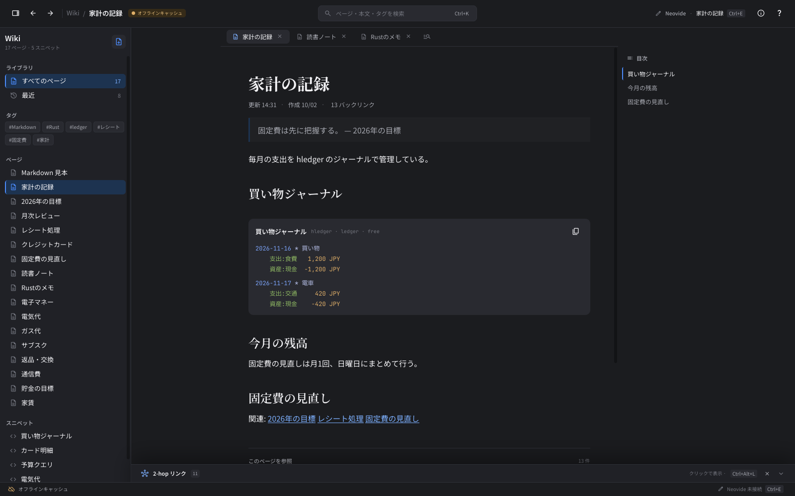
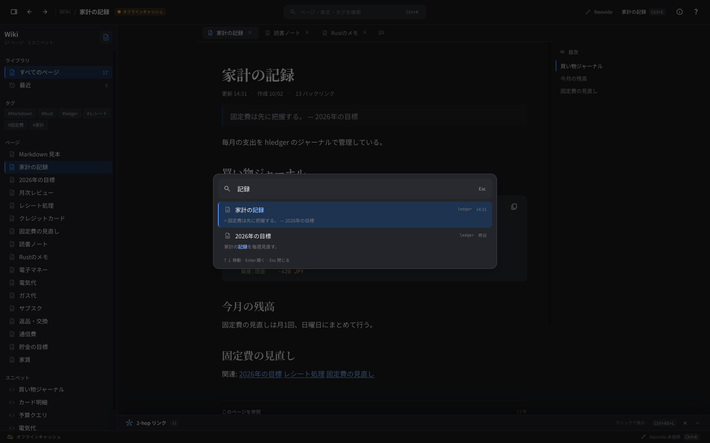
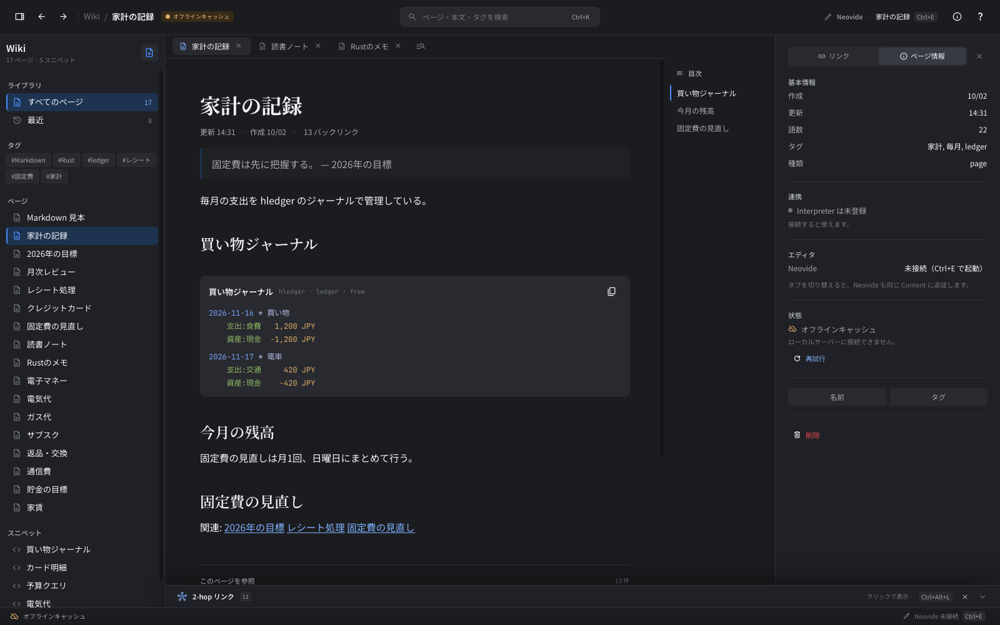
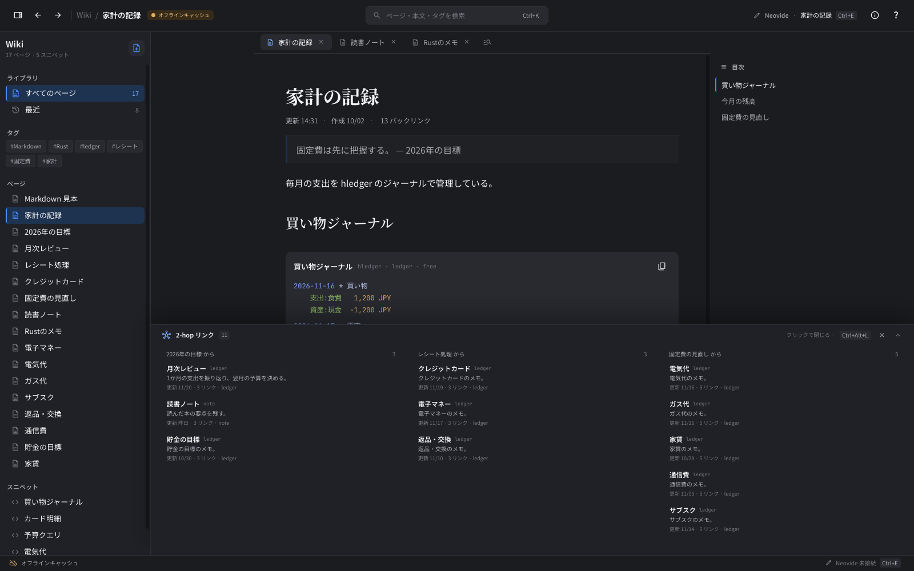
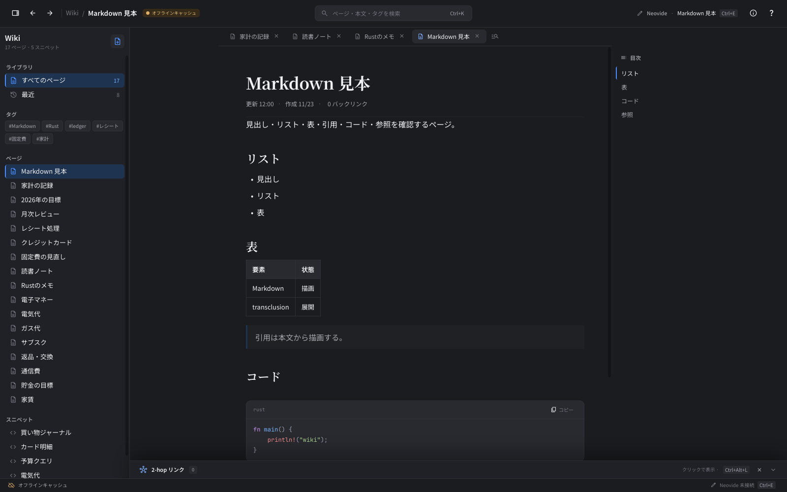
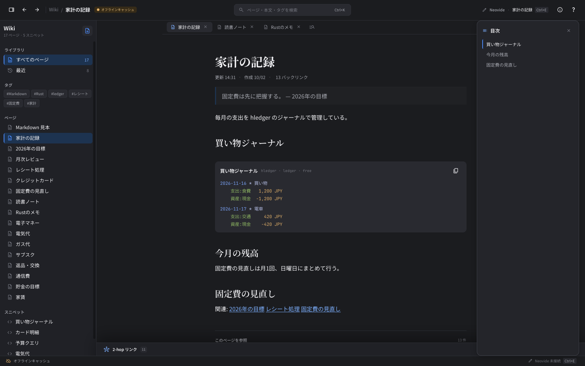
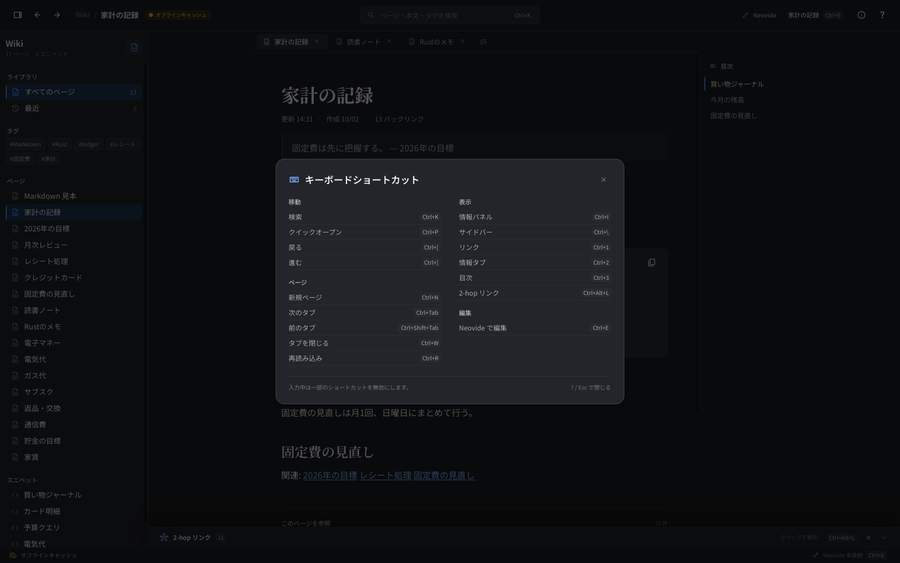
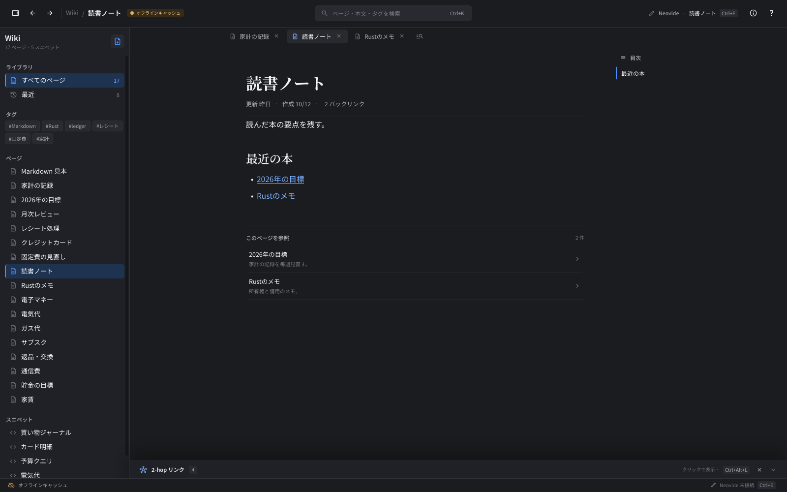

# Wiki GUI refresh

Last updated: 2026-11-24

The previous v5 mockup (`docs/wiki-ui-design.html`) was serviceable but not good: four
permanent columns at 11–13 px, a bottom shelf that covered the article, and an inspector
that squeezed the reading width. This pass replaces the shell's visual system and reading
layout rather than adding more chrome on top of it. A second pass added Material Symbols,
tooltips, context menus, tree-sitter code colouring, an inspector that reflows the article,
and a cleaner result/status region.










## Framework decision

**Stay on AntiWebUI.** Two independent audits of the pinned framework
(`6908e311…`) found no capability that blocks the Wiki UI:

- `rich_text` / `span` gives inline bold, italic, strike, code and clickable links.
- Document-wide selection, copy, primary selection and Japanese IME are implemented.
- `markdown_view`, `text_editor`, `code` (tree-sitter), SVG, popups, transitions and
  accessibility roles exist in the same revision. The app enables `code`; `markdown_view`
  is pulled in directly with `default-features = false`, so Mermaid and math stay out.
- Heading anchors are still private, so the article keeps its own heading/code/embed
  nodes and only sends prose, lists, tables and quotes through `markdown_view`.
- The missing polish was app-side: a hand-written Markdown renderer, no link routing,
  an inspector that was always open, and a hover-only shelf.

The genuine framework gaps are narrow: no AT-SPI bridge on Linux, no HTTP image fetch,
and no CSS media queries. None require a rewrite. Alternatives were evaluated and
rejected for this app: iced/egui lack document-wide selectable rich text, Slint's
`StyledText` omits headings/tables/images and is GPL-or-paid, Tauri adds a Linux WebKitGTK
runtime and a socket bridge, GTK4 is the credible long-term fallback but needs all
Markdown/table/code rendering rebuilt. The maintenance risk of a git-only framework
remains, so the pin should be vendored and upgraded deliberately.

## What changed

### A quieter, more editorial reading surface

- IBM Plex Sans JP for chrome and Noto Serif CJK JP for page titles and H2/H3.
- 33 px serif title, wider 800 px article, 1.78 body line height, calmer graphite palette.
- The article ends with **このページを参照** (backlinks) so the graph is visible without
  opening a panel.
- Inline Markdown is rendered with `rich_text`: `**bold**`, `*italic*`, `~~strike~~`,
  `` `code` ``, `[[wiki links]]` (clickable, resolved by title or Content ID), and
  `[label](url)`.
- Tables gained a header surface and roomier cells; quotes became a tinted card; fenced
  code has a header with a copy button.

### The inspector is an on-demand column

Ctrl+I / Ctrl+1 / Ctrl+2 opens a 360 px inspector for links and page properties. It is part
of the layout, so opening it reflows the article instead of cutting a card in half. The
default view is content-first; closing it restores the full reading width. The segmented
control is only `リンク` / `ページ情報`; the outline never lives here. The 2-hop shelf no longer
opens on hover (it was easy to trigger while scrolling) and sits above the status bar with
only its 36 px handle visible until clicked or `Ctrl+Alt+L`.

### A real icon set, tooltips and context menus

- Material Symbols Outlined, one small font per used glyph, replaces the text-glyph
  stand-ins (`▤`, `◈`, `×`, `◎`, …). Icons are 14–18 px and inherit the surrounding colour.
- Every icon button and truncated page row has a tooltip with its shortcut.
- Right-click menus cover tabs (close, close others, close right, copy link), page and
  snippet rows (open, copy link, rename, tags, delete), links and 2-hop rows, and the
  article (copy page link, inspector, Neovide).
- Copy actions confirm with a short toast instead of failing silently.

### 目次 and ページ情報 are separate surfaces

The outline is a 176 px borderless rail inside the reading block; the block itself is
`article (≤800) + 目次 (176)` and is centred as a unit. ページ情報 is a separate 360 px
inspector outside that block. They never share a header or a segmented control.

At 1600 the sizes are exact: `264 + 800 + 176 = 1240` with the inspector closed, and
`264 + 800 + 176 + 360 = 1600` with it open. The rail hides only when the remaining reading
block would be narrower than 900 px (for example 1440 with the inspector open); at that
point `Ctrl+3` or the toolbar TOC button opens a 280 px floating 目次 panel.

- Clicking an entry scrolls the heading to 24 px below the top edge; it no longer uses
  `scroll_into_view`'s bottom-aligned minimal scroll.
- Scrolling the article updates the active entry (scroll spy on `on_scrolled`), so the rail
  tracks the section the reader is actually in.
- Rows show H3 indentation, truncate at 26 characters, and carry the full heading in a
  tooltip.

### Markdown: `markdown_view` for prose, custom nodes where they matter

The article is rendered in segments:

- headings, fenced code, embeds, transclusions and interpreter panels stay app-rendered;
- prose, lists, tables, quotes and rules go through `anti-webui-markdown`'s
  `markdown_view` with a theme matched to the app.

This keeps the outline anchors and the code copy button while gaining GFM tables, task
lists, escaped tables and the upstream parser. `[[wiki links]]` are rewritten to
`[label](wiki:target)` and routed back through the same target resolver; external links
copy their URL with a toast. Fenced code uses `anti-webui-code` (tree-sitter); ledger keeps
its app-specific highlighter.

### Shortcuts are visible

- `?` opens a keyboard cheat sheet; the toolbar also has a `?` button.
- Every icon-only control has a tooltip with its chord; the inspector segments show their
  chords in tooltips rather than inline text.
- The `+` in the tab strip is now a magnifier with `Ctrl+P`; the sidebar has exactly one
  new-page action (the header `+` with `Ctrl+N`).
- `Ctrl+\` toggles the library; `Ctrl+3` opens the outline pane.
- The palette no longer advertises shortcuts that cannot fire while it owns the keyboard.

### Search and the editor loop

- Search highlights the matched bytes in result titles and excerpts; the query stays in the
  input and `--query` makes this reproducible in snapshots.
- While Neovide is attached, a 2s watcher compares the active page revision and refreshes
  the workspace in place without resetting the reader.s scroll. Failures do not overwrite
  the page; closing the editor stops the watcher.

### Navigation and command surfaces

- Toolbar: breadcrumb, centred search field, Neovide status, inspector and outline toggles,
  shortcut help.
- Sidebar: pinned header, no footer; the page list scrolls the full height, tags are capped
  at six, and the duplicate "recent" section is gone. There is one new-page action.
- Tab clicks, wiki links to an already-open page and back/forward now actually switch the
  article. The bug was that the article read `active` untracked while only `tabs` was
  reactive.
- Each tab keeps its own scroll offset and active heading, and the tab list/active tab is
  restored from the cache on the next launch. Switching, closing, deleting or refreshing
  restores that reading position; tab clicks no longer pollute back/forward history.
- `Ctrl+Tab` / `Ctrl+Shift+Tab` cycle tabs and draw a focus ring on the active tab. `Ctrl+3`
  focuses the outline rail; arrows move the active heading and Enter jumps. Space /
  PageUp / PageDown / arrows scroll the article without a pointer.
- Tabs are quieter pills; the "Ctrl+W 閉じる" hint is removed and the tab-strip button is
  a quick-open magnifier with a tooltip.
- Palette: 640 px, 14 px input, selected row uses the muted accent, results show excerpts,
  and the list scrolls instead of growing past the window.
- The status bar has one source statement on the left and one clickable Neovide state on
  the right; it no longer claims "read-only" and "not connected" at the same time.
- The header drops the decorative eyebrow, word count and comma-separated tag run.
- Empty pages show a `Neovide で書き始める` card instead of a blank article; a wiki with no
  pages gets a real welcome state instead of fixtures or an impossible placeholder. Loose
  `!` fences remain visible as code until converted; `id:` and `#fragment` wiki links
  resolve; aliases and a clickable backlink count are surfaced in the property panel.

## Snapshot commands

`wiki-gui` renders any of these states offscreen for documentation and review:

```sh
target/debug/wiki-gui --snapshot docs/wiki-gui-home.png
target/debug/wiki-gui --search --query 記録 --snapshot docs/wiki-gui-search.png
target/debug/wiki-gui --shelf --snapshot docs/wiki-gui-shelf.png
target/debug/wiki-gui --info --snapshot docs/wiki-gui-info.png
target/debug/wiki-gui --outline --snapshot docs/wiki-gui-outline.png
target/debug/wiki-gui --shortcuts --snapshot docs/wiki-gui-shortcuts.png
target/debug/wiki-gui --tab 1 --snapshot docs/wiki-gui-tab2.png
target/debug/wiki-gui --empty --snapshot docs/wiki-gui-empty.png
target/debug/wiki-gui --page "Markdown 見本" --snapshot docs/wiki-gui-markdown.png
target/debug/wiki-gui --width 1280 --height 800 --snapshot docs/wiki-gui-1280.png
```

## Still open

- Keyboard focus is partial: the active tab and the focused outline row now draw rings, and
  Ctrl+Tab / Ctrl+3 / arrows / Enter work. Sidebar rows, backlinks and the tab overflow menu
  are still pointer-first.
- Session restore covers tabs, active tab, scroll offset and active heading, but not the
  library/inspector state. Following many links still creates many tabs; Ctrl+Tab reaches
  them, but there is no visual overflow menu.
- Fenced code is now coloured by `anti-webui-code` (tree-sitter, 14 languages); the old
  hand-written highlighter remains only for ledger/hledger, which tree-sitter does not cover.
- The Markdown split is line-based: setext headings, fences nested in lists and blockquote
  headings are rendered by `markdown_view` but do not appear in the outline. A real block
  scanner (or the upstream heading-anchor API) is the next correctness step.
- Neovim position sync is one-way: outline and fragment navigation call
  `:WikiGoTo <id> <line>` in the editor. The reverse direction (Neovim -> GUI) needs an
  `editor_state` RPC, debouncing, and must yield to edits and conflicts; pixel-perfect
  scroll sync is deliberately out of scope.
- Tabs still use the compact pill treatment and the 2-hop shelf is still a three-column
  grid; both are candidates for the next visual pass.
- Destructive delete has a confirm step but no undo.
- Linux screen readers need an app-side AccessKit/AT-SPI bridge.
- No local image/SVG rendering in the article yet.

See [implementation status](wiki-implementation-status.md) for verification and remaining
app gaps.
